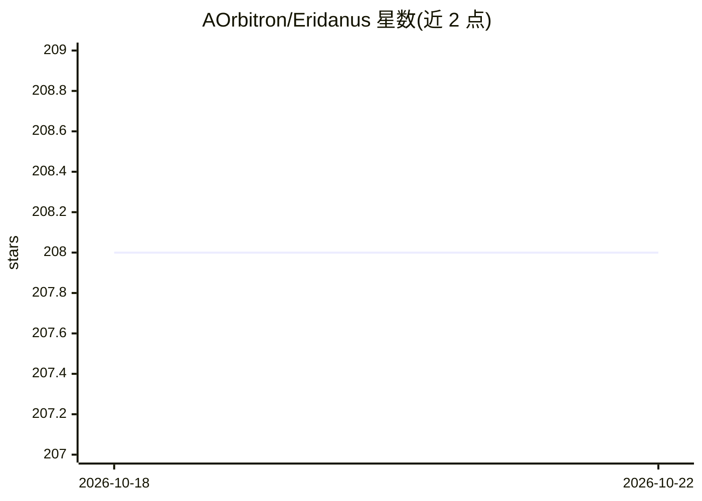

# AOrbitron/Eridanus

⭐ 208 · Python · NOASSERTION · 推送 2026-10-19 · [GitHub](https://github.com/AOrbitron/Eridanus) · [官网](https://eridanus.netlify.app) · 个人维护 · 中文 README

**基于 OneBot 协议的多功能 QQ bot 与 Python 开发框架**

以 OneBot v11 协议标准与事件驱动 Hub 为核心的多端 Bot 框架：QQ、Telegram、WebUI、Android 悬浮窗等多端消息统一规范化为 OneBot 事件，插件仅在内存中加载一次即可服务多个平台，支持跨端上下文绑定与长期记忆互通。以 LLM function calling 构建功能调用机制，并支持不接入 QQ 的纯 Live2D 桌宠模式。Telegram 端提供相册合并、文件原样传输等能力。采用 CC BY-NC-SA 4.0 许可证，禁止商业用途。

## 筛选速览

| 维度 | 判定 | 备注 |
|---|---|---|
| AI 角色 | `ai-ecosystem` | LLM/agent 周边工具 |
| 许可风险 | `none` | NOASSERTION |
| 部署形态 | `None` |  |
| 模型依赖 | — | README 未给出锁定关系 |
| 硬件要求 | — | 无带数字的原话,不猜 |
| 安装摩擦 | `low` | 无编译、无系统依赖或容器化 |
| 成熟度 | — | 结构信号不足 |

## 能力要点

- OneBot v11 + WebSocket Hub 多端桥接，单实例多客户端免二次启动插件
- 以 LLM function calling 为核心的功能调用机制
- Telegram 会话与 QQ 用户跨端上下文绑定与记忆互通
- 支持不接入 QQ 的纯 Live2D 桌宠模式

## 适用场景

- 搭建同时接入 QQ 与 Telegram 的多功能 Bot
- 以框架为基础开发自己的 Bot 插件
- 将 Telegram 会话与 QQ 用户上下文打通实现跨端对话

## 场景标签

`Agent 框架` `聊天机器人` · 领域:Agent 开发

## 证据(README 行号)

> L5: _🎊 基于 OneBot 协议的多功能bot兼python开发框架 🎊_
> L32: Eridanus 采用基于 **OneBot v11 协议标准**与**事件驱动中心 Hub** 的多端统一桥接架构：无需重复启动多份 Bot 核心插件，通过 WebUI 服务端作为 WebSocket Hub 中转，实现 QQ、

## 星数曲线

2026-10-18 208 → 2026-10-22 208（+0）

---
*卡片 v1 · prompt 1.4 · 生成 2026-10-22 · 置信度 mid · 依据 README sha `2e6f11abce60` · [字段定义](../../DATASET.md)*
