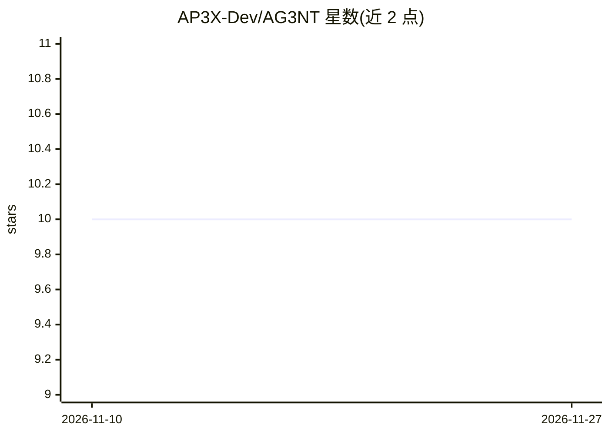

# AP3X-Dev/AG3NT

⭐ 10 · TypeScript · MIT · 推送 2026-05-25 · [GitHub](https://github.com/AP3X-Dev/AG3NT) · 组织维护

**本地优先的个人多 Agent 编排平台，基于 DeepAgents 构建**

由 Gateway、Agent Worker 与 Web UI 三部分组成的本地优先多 Agent 平台，基于 DeepAgents 实现。Gateway 提供 HTTP/WebSocket API 与渠道适配，Agent Worker 运行技能系统与计划/记忆中间件，Next.js Web 控制面板提供流式聊天、制品管理、MCP 服务器管理、浏览器自动化界面与系统日志。支持 CLI/TUI/Telegram/Discord 多渠道接入、敏感操作 HITL 审批、心跳与 cron 调度以及主设备+伴生设备的多节点架构。安装方式为分组件以 npm/pnpm/pip 启动，Windows 提供统一脚本。

## 筛选速览

| 维度 | 判定 | 备注 |
|---|---|---|
| AI 角色 | `ai-ecosystem` | LLM/agent 周边工具 |
| 许可风险 | `permissive` | MIT |
| 部署形态 | `library` | 以包/库形式分发 |
| 模型依赖 | locked-api |  |
| 硬件要求 | — | 无带数字的原话,不猜 |
| 安装摩擦 | `low` | 无编译、无系统依赖或容器化 |
| 成熟度 | — | 结构信号不足 |

## 能力要点

- 多模型接入：Anthropic、OpenAI、OpenRouter、Kimi、Google Gemini，可通过环境变量配置默认 provider 与模型
- 多渠道适配：CLI、TUI、Telegram、Discord
- SKILL.md 格式的模块化技能系统与技能发现/触发匹配
- HITL 审批、DM 配对等安全机制与心跳/cron 调度、多节点能力路由

## 适用场景

- 在本地搭建并编排自主运行的 AI Agent
- 通过 Telegram/Discord 等渠道与个人 Agent 交互
- 用 Web 控制面板管理技能、MCP 服务器与子 Agent

## 场景标签

`多智能体` `浏览器自动化` · 领域:Agent 开发

## 证据(README 行号)

> L4: Local-first personal AI agent platform built on DeepAgents.
> L21: │   ├── gateway/     # Gateway daemon (HTTP + WebSocket + channels)
> L114: |M1: Core Agent Runtime|✅ Complete|DeepAgents integration, multi-model support|

## 星数曲线

2026-11-10 10 → 2026-11-27 10（+0）

---
*卡片 v1 · prompt 1.4 · 生成 2026-11-20 · 置信度 high · 依据 README sha `0f8182e5c70c` · [字段定义](../../DATASET.md)*
