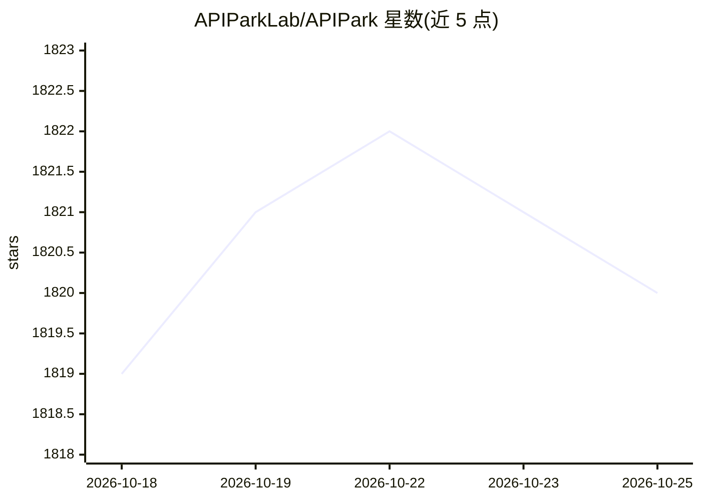

# APIParkLab/APIPark

⭐ 1,819 · TypeScript · Apache-2.0 · 推送 2026-09-09 · [GitHub](https://github.com/APIParkLab/APIPark) · [官网](https://apipark.com) · 组织维护 · 中文 README

**面向开发者的 AI 网关与 API 开发者门户，统一接入 100+ 模型**

开源 AI 网关与 API 开发者门户，Apache 2.0 许可。功能包括接入 100+ 主流 AI 模型并将模型与提示模板组合成 REST API、统一 API 请求/返回数据格式使切换模型不影响应用、团队内 API 分享、应用与密钥管理、调用监控图表与日志导出。同时提供云原生 API 网关能力：集群部署与大规模流量处理、REST API 生命周期管理与调用关系治理、多租户与订阅审批。通过一条 curl 脚本命令部署。路线图包括接入 API 市场、集成 LangChain/Dify 等 Agent 框架、智能 API 编排。面向开发者与企业团队。

## 筛选速览

| 维度 | 判定 | 备注 |
|---|---|---|
| AI 角色 | `ai-ecosystem` | LLM/agent 周边工具 |
| 许可风险 | `permissive` | Apache-2.0 |
| 部署形态 | `None` |  |
| 模型依赖 | — | README 未给出锁定关系 |
| 硬件要求 | — | 无带数字的原话,不猜 |
| 安装摩擦 | `low` | 无编译、无系统依赖或容器化 |
| 成熟度 | — | 结构信号不足 |

## 能力要点

- 统一 100+ AI 模型的 API 请求与返回格式
- AI 模型+提示模板组合为 REST API
- 开发者门户、订阅审批与 API 密钥管理
- 多租户管理与 API 调用监控/日志导出

## 适用场景

- 统一团队对多家 AI 模型的 API 接入与切换
- 把模型加提示词封装为内部 REST API 分享给团队
- 治理内部与第三方 API 调用关系并保障合规安全

## 场景标签

`模型网关` · 领域:Agent 开发

## 证据(README 行号)

> L11:  🦄 APIPark is an open-source, all-in-one AI gateway and API developer portal, helping developers and enterprises ea
> L14: 1. Quickly connect to 100+ AI models, supporting all mainstream AI Companies!

## 星数曲线

2026-10-18 1,819 → 2026-10-25 1,820（+1）

---
*卡片 v1 · prompt 1.4 · 生成 2026-10-21 · 置信度 high · 依据 README sha `470ae4966519` · [字段定义](../../DATASET.md)*
