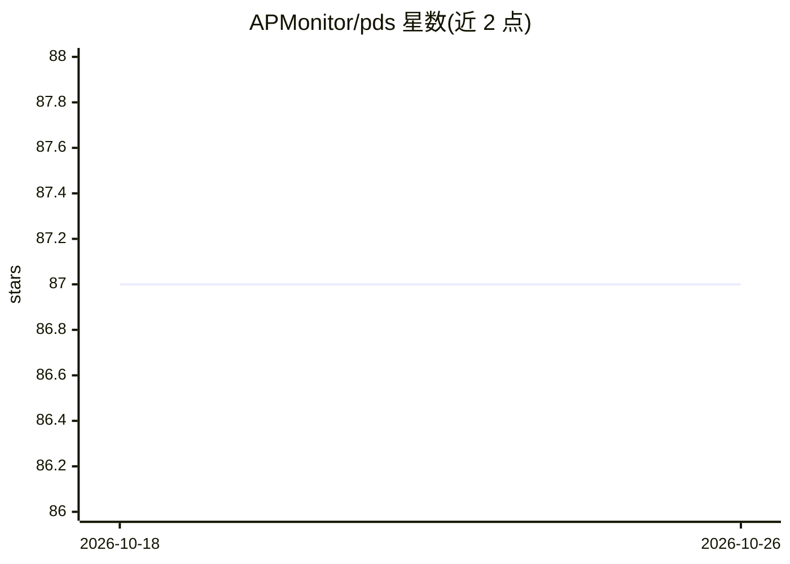

# APMonitor/pds

⭐ 87 · Jupyter Notebook · MIT · 推送 2026-09-01 · [GitHub](https://github.com/APMonitor/pds) · [官网](https://apmonitor.com/pds) · 组织维护

**面向工程师的机器学习课程材料库（Python）**

APMonitor 维护的机器学习工程课程仓库：覆盖有监督与无监督学习方法，主题包括分类、回归、降维，结合线性代数、统计与优化的数学细节与工程案例研究；课程包含动手小组项目，目标是掌握 Python 中实现的机器学习方法与超参数调整。课程页面见 apmonitor.com/pds，README 未给出代码安装或运行说明，属于教学材料而非可直接安装的软件库。

## 筛选速览

| 维度 | 判定 | 备注 |
|---|---|---|
| AI 角色 | `ai-knowledge` | 知识聚合/清单类 |
| 许可风险 | `permissive` | MIT |
| 部署形态 | `None` |  |
| 模型依赖 | — | README 未给出锁定关系 |
| 硬件要求 | — | 无带数字的原话,不猜 |
| 安装摩擦 | `low` | 无编译、无系统依赖或容器化 |
| 成熟度 | — | 结构信号不足 |

## 能力要点

- 综述有监督/无监督学习方法：分类、回归、降维
- 数学细节与工程案例研究结合
- 第二阶段为动手小组项目
- 以不确定度量化方式沟通机器学习决策

## 适用场景

- 工程师系统学习机器学习理论与应用
- 课程中完成动手小组项目
- 了解分类/回归/聚类的适用场景

## 场景标签

`教程课程` · 领域:学习与行业

## 证据(README 行号)

> L3: Machine learning is a convergence of linear algebra, statistics, optimization, and computational methods to allow co
> L7: The course combines mathematical details with several case studies that provide an intuition for machine learning wi

## 星数曲线

2026-10-18 87 → 2026-10-26 87（+0）

---
*卡片 v1 · prompt 1.4 · 生成 2026-10-23 · 置信度 high · 依据 README sha `fc8fd10475c6` · [字段定义](../../DATASET.md)*
