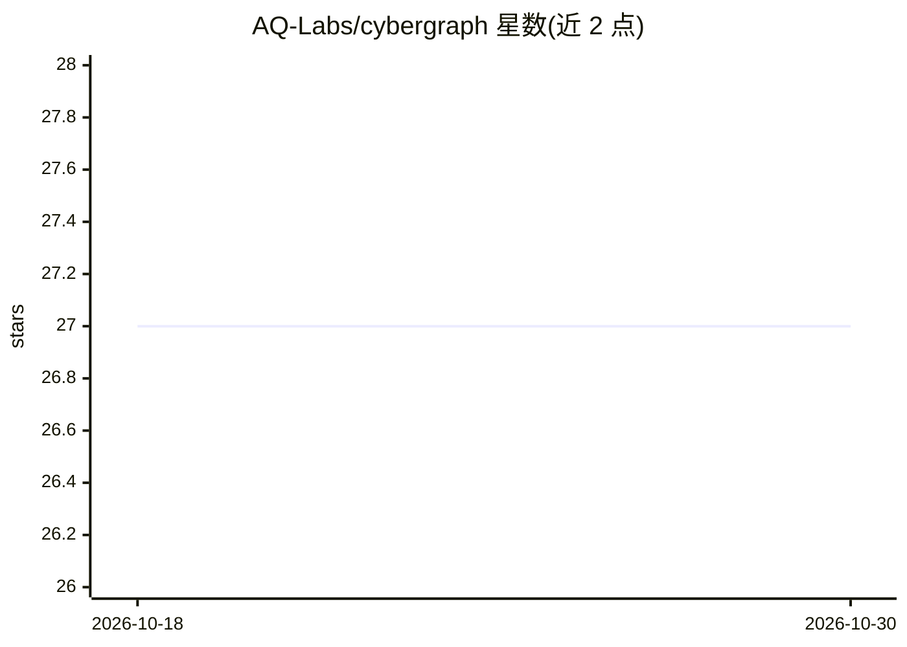

# AQ-Labs/cybergraph

⭐ 27 · Python · MIT · 推送 2026-10-28 · [GitHub](https://github.com/AQ-Labs/cybergraph) · 组织维护

**离线安全验证器：为代码变更出具带证据的 ACCEPT/REVIEW 裁决**

面向 AI 生成代码的安全审查工具：将仓库构建为本地 SQLite 安全知识图（函数、调用、入口、守卫、污点数据流、敏感 sink），对每次变更做确定性验证并输出 ACCEPT/REVIEW 裁决，附文件/行号/规则引证。支持 Python/JS/TS/Go/Java/C# 六类语言分析、CI 策略门禁、交互式离线 HTML 报告、A–F 评级、导入 Semgrep/OSV/SARIF 等扫描结果，并通过 MCP 工具接入 AI 编码助手。默认完全离线，LLM 仅可选用于措辞。以 pip 包提供 CLI。

## 筛选速览

| 维度 | 判定 | 备注 |
|---|---|---|
| AI 角色 | `ai-ecosystem` | LLM/agent 周边工具 |
| 许可风险 | `permissive` | MIT |
| 部署形态 | `library` | 以包/库形式分发 |
| 模型依赖 | — | README 未给出锁定关系 |
| 硬件要求 | — | 无带数字的原话,不猜 |
| 安装摩擦 | `low` | 无编译、无系统依赖或容器化 |
| 成熟度 | — | 结构信号不足 |

## 能力要点

- 仓库→本地安全知识图，对变更输出确定性 ACCEPT/REVIEW 裁决与引证
- 分析 Python、JS/TS、Go、Java、C# 五类语言的跨文件攻击路径（route→sink）
- 导入 Semgrep/OSV/SARIF/Gitleaks 报告并用 EPSS/KEV/CVSS 离线富化
- MCP 工具暴露给 AI 编码助手，可作 agent 回合/提交时钩子运行

## 适用场景

- AI 编码代理提交后自动做独立安全验证，而非让写代码的模型自查
- CI 中用策略门禁将 REVIEW 裁决转为 block/warn 构建门禁
- 把扫描器告警关联成可达攻击路径并按证据排序

## 场景标签

`代码审查` `网络安全` `知识图谱` · 领域:编码与开发

## 证据(README 行号)

> L16: CyberGraph is an **independent, offline security verifier for code changes**. It checks each change against your ap
> L23: Install it as a hook and it runs the moment an agent finishes a turn or a commit is made — verification that doesn'
> L106: - Exposes MCP tools for AI coding assistants.

## 星数曲线

2026-10-18 27 → 2026-10-30 27（+0）

---
*卡片 v1 · prompt 1.4 · 生成 2026-10-26 · 置信度 high · 依据 README sha `78f77ac01ed5` · [字段定义](../../DATASET.md)*
