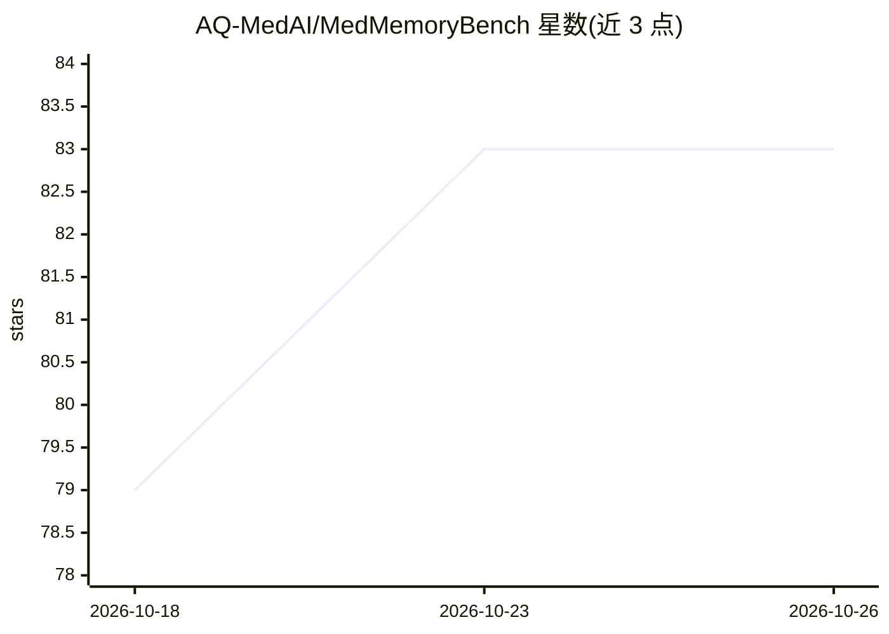

# AQ-MedAI/MedMemoryBench

⭐ 83 · Python · Apache-2.0 · 推送 2026-10-08 · [GitHub](https://github.com/AQ-MedAI/MedMemoryBench) · [官网](https://x.com/AQ_MedAI) · 组织维护 · 中文 README

**医疗对话场景下评测 Agent 记忆方法的基准框架**

NeurIPS 2026 接收的评测框架，面向医疗个性化对话场景评估 Agent 记忆能力。提供 20 个纵向患者人设、约 2,020 轮多会话医患对话（中英双语）与 1,986 条覆盖 6 类临床动机查询的评测集；实现 14 个基线方法（经典 RAG、agentic 记忆系统、图记忆系统），通过 BaseAgent 统一接入，采用字符串匹配与 LLM-as-a-Judge 双指标，YAML 驱动配置，支持 OpenAI/BigModel/Azure 多 LLM 提供方与本地/远程嵌入模型，可跨基准评测（LoCoMo、AMA-Bench）。以 Python 源码仓库形式提供，数据集需从 HuggingFace 单独下载。

## 筛选速览

| 维度 | 判定 | 备注 |
|---|---|---|
| AI 角色 | `ai-ecosystem` | LLM/agent 周边工具 |
| 许可风险 | `permissive` | Apache-2.0 |
| 部署形态 | `library` | 以包/库形式分发 |
| 模型依赖 | — | README 未给出锁定关系 |
| 硬件要求 | — | 无带数字的原话,不猜 |
| 安装摩擦 | `low` | 无编译、无系统依赖或容器化 |
| 成熟度 | — | 结构信号不足 |

## 能力要点

- 20 个纵向患者人设与约 2,020 轮双语医患对话数据集
- 14 个记忆方法基线（3 经典 + 7 agentic + 4 图记忆）
- 字符串匹配 + LLM-as-a-Judge 双指标评测与断点续跑
- YAML 配置驱动，支持 OpenAI/BigModel/Azure 与本地嵌入模型

## 适用场景

- 评测自己的 Agent 记忆方法在医疗对话中的表现
- 复现论文中 14 个基线方法的对比结果
- 在 LoCoMo/AMA-Bench 等基准上做跨基准评测

## 场景标签

`Agent 记忆` `模型评测` · 领域:Agent 开发

## 证据(README 行号)

> L16: **MedMemoryBench** is a benchmark framework for evaluating Agent memory methods, with a focus on memory capability 
> L39: **Unified Evaluation Framework**
> L41: - Multi-metric evaluation: string match + LLM-as-a-Judge

## 星数曲线

2026-10-18 79 → 2026-10-26 83（+4）

---
*卡片 v1 · prompt 1.4 · 生成 2026-10-24 · 置信度 mid · 依据 README sha `07b973397c95` · [字段定义](../../DATASET.md)*
