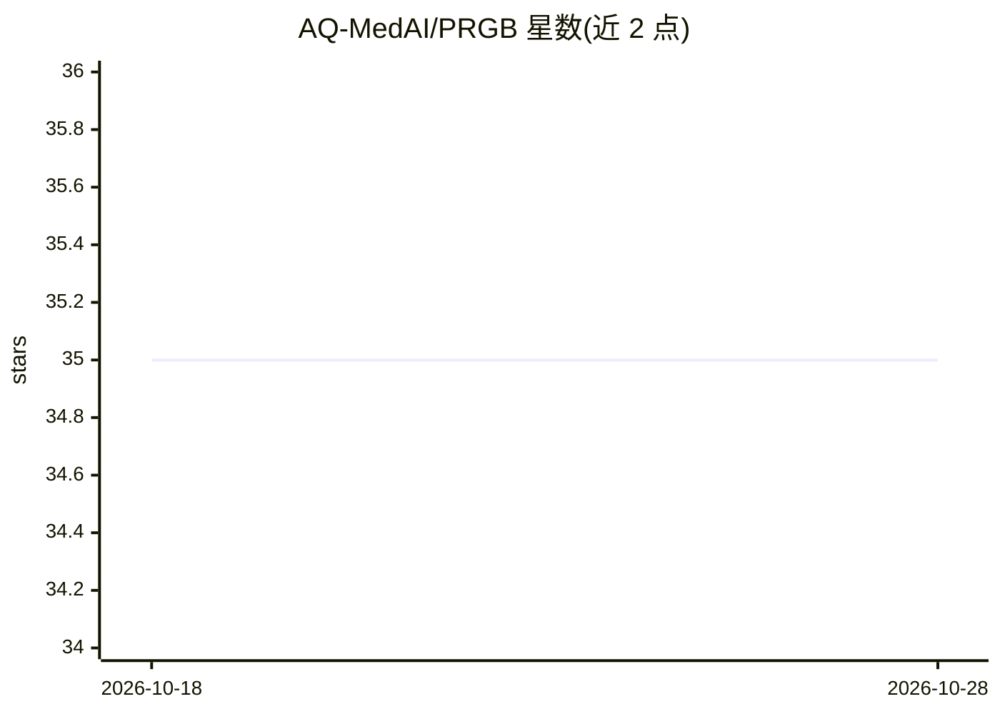

# AQ-MedAI/PRGB

⭐ 35 · Python · NOASSERTION · 推送 2025-11-20 · [GitHub](https://github.com/AQ-MedAI/PRGB) · [官网](https://arxiv.org/abs/2507.22927) · 组织维护 · 中文 README

**RAG 鲁棒性评测基准：用占位符与噪声注入评测量化模型**

AAAI 2026 论文配套的 RAG 评测基准工具：通过占位符替换与三级噪声文档注入构建数据集，从多级过滤、组合、推理等维度评估大模型的文档忠实度与外部知识利用效率，支持中英文数据集，生成评分报告。运行时支持本地 vllm 推理与 API key 两种模型接入，提供 Makefile、shell 脚本与 Python 命令三种运行方式；数据集正在人工校验中，检索系统测试版标注为开发中。面向 RAG 研究者与开发者。

## 筛选速览

| 维度 | 判定 | 备注 |
|---|---|---|
| AI 角色 | `ai-ecosystem` | LLM/agent 周边工具 |
| 许可风险 | `none` | NOASSERTION |
| 部署形态 | `library` | 以包/库形式分发 |
| 模型依赖 | local-ok | 支持本地模型 |
| 硬件要求 | — | 无带数字的原话,不猜 |
| 安装摩擦 | `medium` | 含编译或系统依赖之一 |
| 成熟度 | `idea` | |

## 能力要点

- 占位符+三级噪声注入的评测数据集构造
- 多级过滤/组合/推理多维评分与报告生成
- 本地 vllm 推理与 API 推理两种接入方式
- 中英文双语数据集评测

## 适用场景

- 评测自家 RAG 模型在噪声干扰下的表现
- 对比不同大模型对外部知识的利用与忠实度
- 用占位符多次迭代降低评测随机性

## 场景标签

`模型评测` · 领域:评测与运维

## 证据(README 行号)

> L10: PRGB (Placeholder RAG Benchmark) is a benchmark tool focused on evaluating document faithfulness and external knowl
> L26: - 🎯 **Multi-Model Support**: Supports multiple large language models with local vllm inference

## 星数曲线

2026-10-18 35 → 2026-10-28 35（+0）

---
*卡片 v1 · prompt 1.4 · 生成 2026-10-25 · 置信度 mid · 依据 README sha `48f974c9a762` · [字段定义](../../DATASET.md)*
