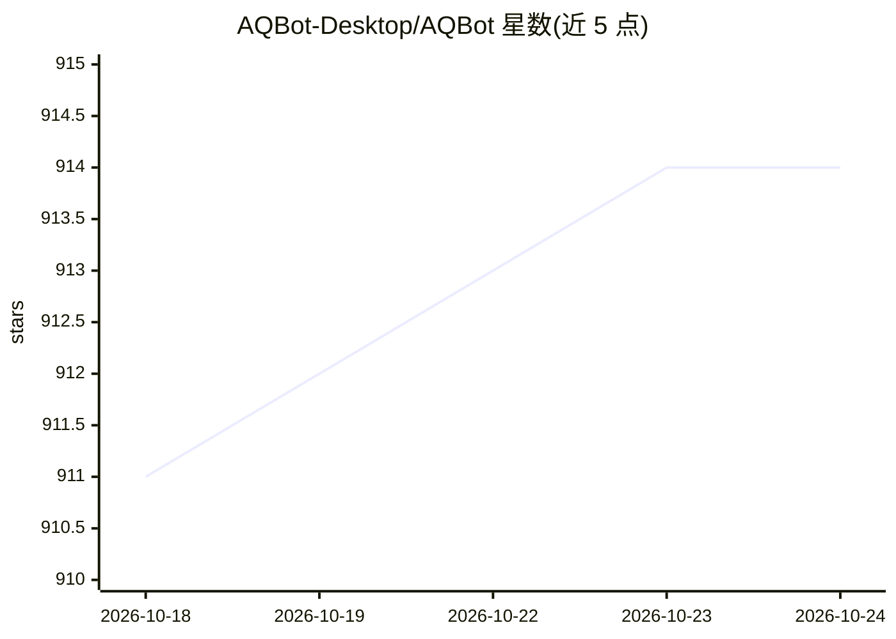

# AQBot-Desktop/AQBot

⭐ 914 · Rust · AGPL-3.0 · 推送 2026-10-21 · [GitHub](https://github.com/AQBot-Desktop/AQBot) · [官网](https://app.aqbot.top) · 组织维护 · 中文 README

**本地优先的桌面 AI 工作台：多服务商对话+Agent+知识库+API网关**

基于 Tauri 的跨平台桌面 AI 客户端：统一多服务商对话（OpenAI/Claude/Gemini/DeepSeek/Qwen 及 OpenAI 兼容端点）、对话内置 Agent 与 ACP Agent 工作台、本地知识库（sqlite-vec）、MCP 工具、Skills 管理与本地 API 网关（暴露 OpenAI/Claude/Gemini 接口）。应用数据与用户文件保留在本机，API Key 用 AES-256 加密。支持从 Releases 下载安装包，覆盖 macOS/Windows/Linux；许可证为 AGPL-3.0。

## 筛选速览

| 维度 | 判定 | 备注 |
|---|---|---|
| AI 角色 | `ai-native` | 本体是模型或模型工具 |
| 许可风险 | `viral` | AGPL-3.0 |
| 部署形态 | `None` |  |
| 模型依赖 | locked-api |  |
| 硬件要求 | — | 无带数字的原话,不猜 |
| 安装摩擦 | `low` | 无编译、无系统依赖或容器化 |
| 成熟度 | — | 结构信号不足 |

## 能力要点

- 连接 OpenAI、Claude、Gemini、DeepSeek、Qwen 及任意 OpenAI 兼容端点
- 双 Agent 形态：对话内置 Agent 与 ACP 独立工作台（Codex/Claude Agent/Gemini CLI 等）
- 本地 API 网关暴露 OpenAI Chat Completions/Responses、Claude 原生与 Gemini 原生接口
- sqlite-vec 本地知识库、MCP 工具与多来源 Skills 管理

## 适用场景

- 在一个桌面应用里管理多家 AI 服务商的对话与模型
- 通过 ACP 工作台运行 Codex、Claude Agent 等编程 Agent 并审批权限
- 把本地配置的服务商通过 API 网关暴露给 Claude Code、Codex CLI 等客户端
- 用本地知识库索引私有文档并附加到对话上下文

## 场景标签

`AI 助手` `模型网关` `知识库管理` · 领域:Agent 开发

## 证据(README 行号)

> L5: AQBot 是一款本地优先的桌面 AI 工作台，统一多服务商对话、ACP Agent、知识库、MCP 工具与 API 网关，并将应用数据和用户文件保留在本机掌控之中。
> L33: - **多服务商对话** — 连接 OpenAI、Claude、Gemini、DeepSeek、Qwen 以及任意 OpenAI 兼容端点，支持自定义 Base URL、API Path、请求头和代理规则。
> L40: - **两种 Agent 使用方式** — AQBot 同时提供对话模块内置 Agent 与独立 ACP Agent 工作台；前者使用用户配置的服务商 API，后者连接 ACP 兼容的外部 Agent 进程，可按模型来源和工作流自

## 星数曲线

2026-10-18 911 → 2026-10-24 914（+3）

---
*卡片 v1 · prompt 1.4 · 生成 2026-10-21 · 置信度 high · 依据 README sha `4ae0f8fb8702` · [字段定义](../../DATASET.md)*
