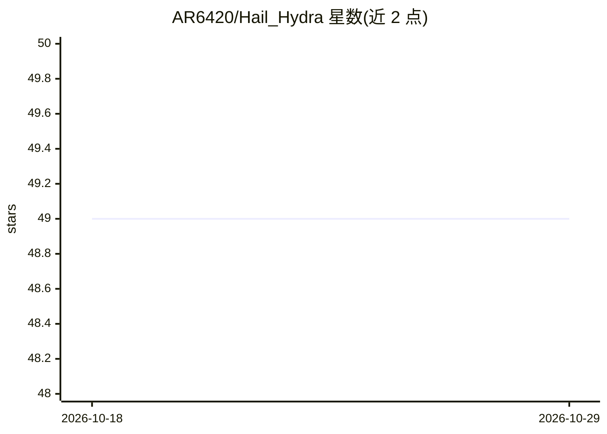

# AR6420/Hail_Hydra

⭐ 49 · JavaScript · MIT · 推送 2026-10-12 · [GitHub](https://github.com/AR6420/Hail_Hydra) · [官网](https://www.npmjs.com/package/hail-hydra-cc) · 个人维护

**面向 AI 编程 CLI 的多 agent 分派工具包：10 个专职 agent 降本提速**

Hydra 是部署到 Claude Code、Gemini CLI、Codex CLI、GitHub Copilot CLI 四种宿主 CLI 的多 agent 工具包：通过 npx 安装器写入各宿主的 agents/commands/hooks 配置，提供 10 个按成本分层固定模型的专职 agent（如 Haiku 层的 scout/guard、Sonnet 层的 coder/architect）、11 个 slash 命令、持久 agent 记忆、代码库依赖图、编辑后验证触点与基于真实会话日志的 token 统计（/hydra:stats，示例节省 51.5%）。README 声明典型单任务成本降低约 50%；Copilot 端为 opt-in 技能，hooks 因上游 bug 暂缓。

## 筛选速览

| 维度 | 判定 | 备注 |
|---|---|---|
| AI 角色 | `ai-ecosystem` | LLM/agent 周边工具 |
| 许可风险 | `permissive` | MIT |
| 部署形态 | `library` | 以包/库形式分发 |
| 模型依赖 | — | README 未给出锁定关系 |
| 硬件要求 | — | 无带数字的原话,不猜 |
| 安装摩擦 | `medium` | 含编译或系统依赖之一 |
| 成熟度 | — | 结构信号不足 |

## 能力要点

- 10 个按 cheap/mid 分层固定模型的专职 agent，配合 fallback 模型链
- 单一 content/ 源生成四种宿主 CLI 的原生配置（/hydra:*、$hydra-*、/hail-hydra）
- /hydra:stats 解析宿主 CLI 会话日志给出真实 token 节省（示例 51.5%）
- 代码库依赖图与 blast-radius 查询（/hydra:map）

## 适用场景

- 在 Claude Code 中把探索、安全扫描等任务分派给低成本模型 agent
- 大改动后自动触发集成验证与代码/安全审查
- 跨多种 AI 编程 CLI 统一使用同一套 agent 角色

## 场景标签

`多智能体` `编码 Agent` · 领域:Agent 开发

## 证据(README 行号)

> L32: **Hydra** is a curated multi-agent toolkit for AI coding CLIs — **Claude Code**, **Gemini CLI**, **Codex CLI**, and
> L73: npx hail-hydra-cc@latest
> L210: |`/hydra:stats`|Show real token usage, delegation rate, and actual savings (parses the host CLI's own session logs

## 星数曲线

2026-10-18 49 → 2026-10-29 49（+0）

---
*卡片 v1 · prompt 1.4 · 生成 2026-10-25 · 置信度 high · 依据 README sha `d62d63dd4d20` · [字段定义](../../DATASET.md)*
