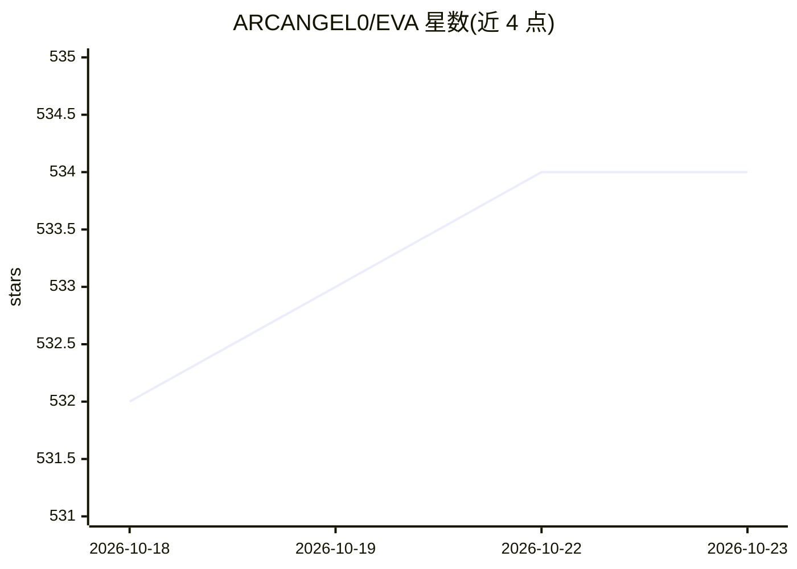

# ARCANGEL0/EVA

⭐ 534 · Python · 推送 2026-06-16 · [GitHub](https://github.com/ARCANGEL0/EVA) · 个人维护

**面向渗透测试人员的 AI 攻击引导 agent（CLI）**

EVA（Exploit Vector Agent）是命令行形态的 AI 渗透测试助手：基于用户输入的目标进行自动枚举建议、漏洞识别与攻击路径规划，生成可在会话中执行/跳过的命令并实时分析输出，支持持久化会话、exploit 情报检索、HTML/PDF 报告与攻击面图谱生成。可选 Ollama（推荐，本地 WhiteRabbit-Neo 模型，约 9.8GB）、OpenAI、Anthropic、Gemini、G4F.dev 及自定义 API 端点作为后端。声明仅限授权环境（CTF、授权渗透测试）使用。

## 筛选速览

| 维度 | 判定 | 备注 |
|---|---|---|
| AI 角色 | `ai-native` | 本体是模型或模型工具 |
| 许可风险 | `none` | — |
| 部署形态 | `library` | 以包/库形式分发 |
| 模型依赖 | local-ok | 支持本地模型 |
| 硬件要求 | — | 无带数字的原话,不猜 |
| 安装摩擦 | `low` | 无编译、无系统依赖或容器化 |
| 成熟度 | — | 结构信号不足 |

## 能力要点

- AI 驱动的攻击策略、自主命令生成与输出实时分析
- 多后端支持：Ollama/OpenAI/Anthropic/Gemini/G4F.dev/自定义 API
- 会话内命令执行流（运行/跳过/追问）与持久化会话
- 生成 PDF/HTML 报告与 HTML 攻击面图谱

## 适用场景

- CTF 比赛中获取枚举与漏洞利用的下一步指引
- 授权渗透测试中辅助攻击路径分析与报告生成
- 在本地 Ollama 模型上离线执行 AI 引导的测试流程

## 场景标签

`网络安全` · 领域:学习与行业

## 证据(README 行号)

> L26: **EVA** is an AI penetration testing agent that guides users through complete pentest engagements with AI-powered a
> L33: - **⑇ Multiple AI Backends**: Support for Ollama, OpenAI GPT, Anthropic, Gemini, G4F.dev and custom API endpoints

## 星数曲线

2026-10-18 532 → 2026-10-23 534（+2）

---
*卡片 v1 · prompt 1.4 · 生成 2026-10-21 · 置信度 high · 依据 README sha `f79043bb4bab` · [字段定义](../../DATASET.md)*
