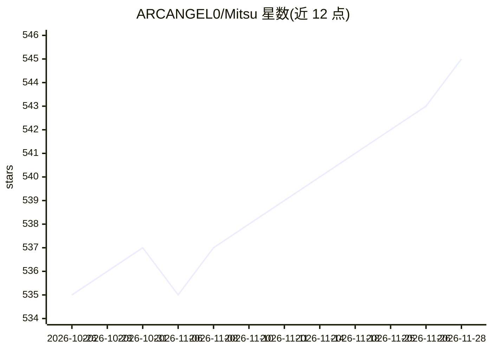

# ARCANGEL0/Mitsu

⭐ 545 · Python · MIT · 推送 2026-11-20 · [GitHub](https://github.com/ARCANGEL0/Mitsu) · 个人维护

**授权渗透测试的 agentic 框架客户端，从侦察到后渗透**

Mitsu 是面向授权渗透测试工作流的 agentic 框架客户端：给定范围内目标与评估目标后，可执行侦察、主机与服务枚举、漏洞研究与验证并延续到后渗透。其 MCP 服务器将所选模型接入 165+ 个 Red Team Armory 工具（17 类）、外部 MCP 服务器与自定义命令封装；每个会话维护包含目标、服务、漏洞、证据的持久 Intel，可生成攻击面地图与评估报告。提供 Recon/Guided/AutoPwn 三种模式及审批机制，需 Python 3.10+，通过 pip 或 GitHub 源码安装。

## 筛选速览

| 维度 | 判定 | 备注 |
|---|---|---|
| AI 角色 | `ai-native` | 本体是模型或模型工具 |
| 许可风险 | `permissive` | MIT |
| 部署形态 | `library` | 以包/库形式分发 |
| 模型依赖 | local-ok | 支持本地模型 |
| 硬件要求 | — | 无带数字的原话,不猜 |
| 安装摩擦 | `low` | 无编译、无系统依赖或容器化 |
| 成熟度 | — | 结构信号不足 |

## 能力要点

- MCP 服务器接入 165+ 个红队工具（17 类）及外部 MCP 服务器
- 会话级持久 Intel 记录目标、服务、漏洞、发现与证据
- Recon/Guided/AutoPwn 三种模式，安装与 sudo 操作需人工审批
- 支持从会话 Intel 生成攻击面地图与评估报告

## 适用场景

- 在授权范围内自动化执行从侦察到后渗透的渗透测试
- 引导式模式下由操作者决定每一步测试方向
- 整理会话证据生成评估报告与攻击面地图

## 场景标签

`网络安全` · 领域:学习与行业

## 证据(README 行号)

> L20: Mitsu is an agentic framework client for authorized penetration-testing workflows. Given an in-scope target and obj
> L26: - **Model providers:** OpenAI, Anthropic, OpenRouter, Ollama local and cloud, DeepSeek, Groq, Mistral AI, Together 

## 星数曲线

2026-10-26 535 → 2026-11-28 545（+10）

---
*卡片 v1 · prompt 1.4 · 生成 2026-11-25 · 置信度 high · 依据 README sha `5c1e714bc081` · [字段定义](../../DATASET.md)*
