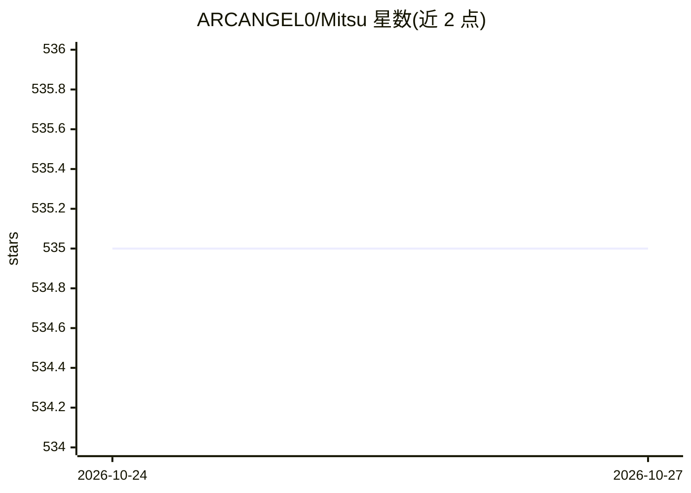

# ARCANGEL0/Mitsu

⭐ 535 · Python · MIT · 推送 2026-10-24 · [GitHub](https://github.com/ARCANGEL0/Mitsu) · 个人维护

**面向授权渗透测试的 AI 红队操作员，带 165+ MCP 工具**

Mitsu 是一个以 chibi 角色呈现的红队助手 CLI/TUI 工具，用于授权渗透测试的完整流程：从侦察、攻击面测绘，到漏洞发现、利用与后渗透。其 MCP 服务器将模型连接到 165+ 个安全工具（17 类目录），模型在工具循环中根据证据选择下一步；会话持续维护 Intel（目标、端口、漏洞线索、发现等）。提供 Recon/Guided/AutoPwn 三种模式，安装缺工具、sudo 等操作需人工批准。支持 OpenAI、Anthropic、OpenRouter、Ollama、DeepSeek 等多种模型提供商。要求 Python 3.10+，pip 或脚本安装。

## 筛选速览

| 维度 | 判定 | 备注 |
|---|---|---|
| AI 角色 | `ai-native` | 本体是模型或模型工具 |
| 许可风险 | `permissive` | MIT |
| 部署形态 | `library` | 以包/库形式分发 |
| 模型依赖 | local-ok | 支持本地模型 |
| 硬件要求 | — | 无带数字的原话,不猜 |
| 安装摩擦 | `low` | 无编译、无系统依赖或容器化 |
| 成熟度 | — | 结构信号不足 |

## 能力要点

- 165+ 红队工具、17 类 Armory 目录经 MCP 服务器暴露给模型
- Recon/Guided/AutoPwn 三种操作模式，安装与 sudo 需人工批准
- 持久化会话 Intel：目标、服务、漏洞线索、发现与证据
- 支持 8 家模型提供商及 OpenAI/Anthropic 兼容自定义端点

## 适用场景

- 授权渗透测试中让 AI 驱动侦察与漏洞验证流程
- 用会话 Intel 维护目标资产与证据记录并生成报告
- 通过对话按需调用 nmap、sqlmap 等 165+ 安全工具

## 场景标签

`网络安全` · 领域:学习与行业

## 证据(README 行号)

> L20: Mitsu is your chibi red-team companion for authorized penetration tests, built to help carry an engagement from the
> L28: - **Model providers:** OpenAI, Anthropic, OpenRouter, Ollama, DeepSeek, Moonshot (Kimi), NVIDIA NIM, and Cloudflare

## 星数曲线

2026-10-24 535 → 2026-10-27 535（+0）

---
*卡片 v1 · prompt 1.4 · 生成 2026-10-23 · 置信度 high · 依据 README sha `e81d4e246572` · [字段定义](../../DATASET.md)*
