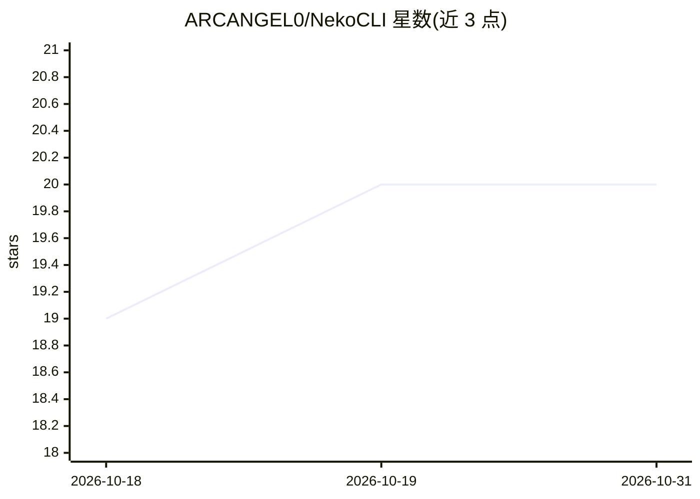

# ARCANGEL0/NekoCLI

⭐ 20 · Python · 推送 2026-05-27 · [GitHub](https://github.com/ARCANGEL0/NekoCLI) · [官网](https://neko.arcangelo.net) · 个人维护

**多模式终端 AI 助手：图像/视频生成、代码与自主渗透测试**

名为 NEKO 的终端 AI 助手 CLI，提供聊天、带实时结果的联网搜索、shell 命令生成与执行、代码生成保存、图像分析与生成编辑、8 秒短视频生成，以及渗透测试模式（-x 问答与 -a 实验性自主多步执行）。聊天与渗透历史持久化于 ~/neko 下的 JSON 文件。默认使用作者自有 API 端点，可改为 Ollama（localhost:11434）离线运行。通过 pip 安装 nekocli 或克隆仓库执行 install.sh。

## 筛选速览

| 维度 | 判定 | 备注 |
|---|---|---|
| AI 角色 | `ai-native` | 本体是模型或模型工具 |
| 许可风险 | `none` | — |
| 部署形态 | `library` | 以包/库形式分发 |
| 模型依赖 | local-ok | 支持本地模型 |
| 硬件要求 | — | 无带数字的原话,不猜 |
| 安装摩擦 | `low` | 无编译、无系统依赖或容器化 |
| 成熟度 | `idea` | |

## 能力要点

- 多模式：联网搜索、shell 执行、代码生成、图像/视频生成与编辑、视觉分析
- 实验性自主渗透测试模式：自动执行命令并根据输出生成后续步骤
- 持久化聊天与渗透历史（~/neko/chat.json、pentest.json）
- 默认免费 API 端点，可选 Ollama 离线模式

## 适用场景

- 在终端里随手提问、读 stdin 日志并分析
- 生成并保存代码脚本、按需求生成 shell 命令
- 渗透测试辅助问答与自主多步执行（实验性）
- 生成、编辑图像与短视频

## 场景标签

`AI 助手` `代码生成` `图像生成` `视频生成` · 领域:编码与开发

## 证据(README 行号)

> L1: **AI assistant for your terminal, able to view, edit or generate images; create short videos; generate and save code
> L18: It supports multiple flags and modes with a tidy formatted and colourful output in your terminal window such as per
> L23: - **Multiple Modes** – AI chat with GPT5 + Web search and real time content, shell commands and execution, code gen

## 星数曲线

2026-10-18 19 → 2026-10-31 20（+1）

---
*卡片 v1 · prompt 1.4 · 生成 2026-10-28 · 置信度 high · 依据 README sha `29f9095186d9` · [字段定义](../../DATASET.md)*
