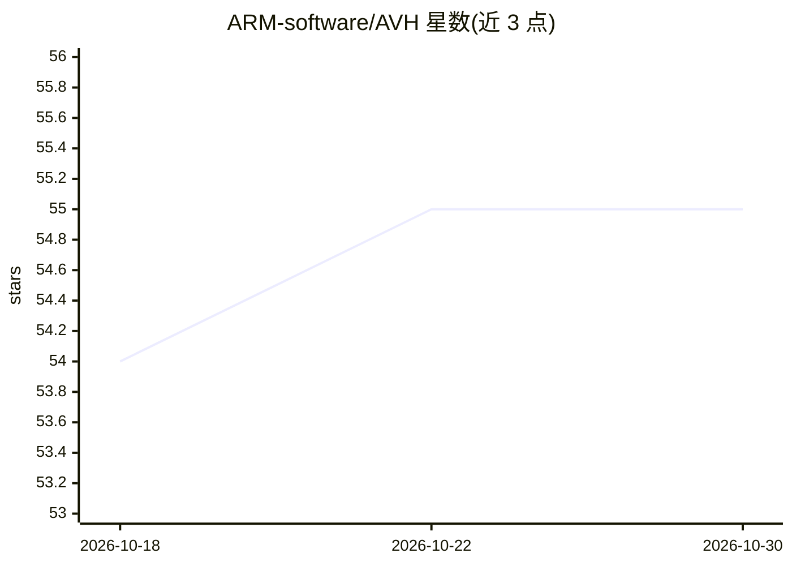

# ARM-software/AVH

⭐ 55 · Python · Apache-2.0 · 推送 2026-10-22 · [GitHub](https://github.com/ARM-software/AVH) · [官网](https://arm-software.github.io/AVH) · 组织维护

**Arm 固定虚拟平台（FVP）的开发者资源与示例集合**

Arm 官方仓库，提供 Fixed Virtual Platform（FVP）仿真的开发者资源、示例工程与参考实现：FVP 模型在 Windows/Linux 主机上直接模拟 Cortex-M 参考平台，作为固件验证的虚拟硬件目标。模型包含于 Keil MDK，可接入 Keil Studio、命令行环境与 CI/CD 流程。仓库内容以 ARM::AVH_FVP 软件包形式发布在 keil.arm.com，含示例工程、Corstone FVP 板级支持层、Virtual Interface API 及驱动/Python 脚本，并提供 Doxygen 文档源与 GitHub Action 工作流。

## 筛选速览

| 维度 | 判定 | 备注 |
|---|---|---|
| AI 角色 | `ai-enhanced` | 去掉 AI 部分产品仍成立 |
| 许可风险 | `permissive` | Apache-2.0 |
| 部署形态 | `None` |  |
| 模型依赖 | — | README 未给出锁定关系 |
| 硬件要求 | — | 无带数字的原话,不猜 |
| 安装摩擦 | `low` | 无编译、无系统依赖或容器化 |
| 成熟度 | — | 结构信号不足 |

## 能力要点

- FVP 模型在 Windows/Linux 主机直接运行，作为固件验证的虚拟 Cortex-M 目标
- 提供示例工程与 Corstone FVP 板级支持层
- Virtual Interface API 含驱动与 Python 脚本
- 内容以 ARM::AVH_FVP Pack 形式发布，含 GitHub Action 发布/验证工作流

## 适用场景

- 在无实体硬件的主机上运行与验证 Cortex-M 固件
- 在 CI/CD 流水线中用 FVP 做自动化固件测试
- 了解并集成 Arm FVP 的虚拟接口 API

## 场景标签

 · 领域:嵌入式/硬件仿真

## 证据(README 行号)

> L10: The repository contains developer resources, examples, and reference implementations for Arm Fixed Virtual Platform
> L12: FVP simulation models of Arm Cortex-M reference platforms run directly on your host system (Windows or Linux), prov

## 星数曲线

2026-10-18 54 → 2026-10-30 55（+1）

---
*卡片 v1 · prompt 1.4 · 生成 2026-10-24 · 置信度 mid · 依据 README sha `fd30fb06c886` · [字段定义](../../DATASET.md)*
