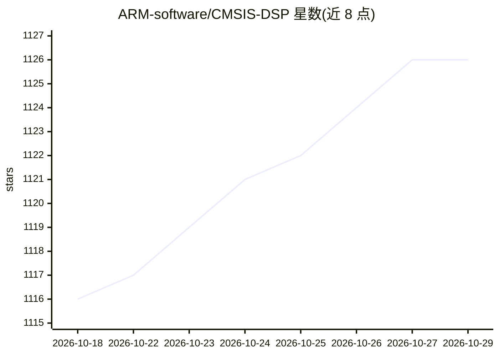

# ARM-software/CMSIS-DSP

⭐ 1,126 · C · Apache-2.0 · 推送 2026-10-28 · [GitHub](https://github.com/ARM-software/CMSIS-DSP) · [官网](https://arm-software.github.io/CMSIS-DSP) · 组织维护

**面向 Cortex-M/A 的嵌入式优化计算内核库（DSP/FFT/ML）**

Arm 维护的嵌入式系统优化计算库，为 Cortex-M 与 Cortex-A 提供基础数学（实数/复数/四元数/线性代数）、滤波、FFT/MFCC/DCT 变换、统计及经典 ML（SVM、聚类距离函数）内核，支持 f64/f32/f16/q31/q15/q7 多种数据类型，在 Helium/Neon 扩展可用时提供向量化版本。附带可选的 C++ 高层 API（DSP++，header-only）、实验性 autodiff 扩展与兼容 NumPy 的 Python wrapper。构建途径覆盖 CMSIS-Pack、cmake、Makefile、Zephyr；限制：DSP++ 在启用 ARM_MATH_NEON 的构建中不受支持，autodiff 为实验性。

## 筛选速览

| 维度 | 判定 | 备注 |
|---|---|---|
| AI 角色 | `ai-ecosystem` | LLM/agent 周边工具 |
| 许可风险 | `permissive` | Apache-2.0 |
| 部署形态 | `library` | 以包/库形式分发 |
| 模型依赖 | — | README 未给出锁定关系 |
| 硬件要求 | — | 无带数字的原话,不猜 |
| 安装摩擦 | `medium` | 含编译或系统依赖之一 |
| 成熟度 | `idea` | |

## 能力要点

- 提供 f64/f32/f16/q31/q15/q7 多数据类型的计算内核
- Helium/Neon 向量化支持与 -O3 -ffast-math 编译优化指引
- 可选 header-only C++ API（DSP++，含 loop fusion）
- 兼容 NumPy 的 Python wrapper，便于从设计迁移到 C 实现

## 适用场景

- 在 Cortex-M/A 嵌入式设备上实现 FFT、滤波与矩阵运算
- 嵌入式设备上运行 SVM 等经典 ML 推理内核
- 在 Python 中设计算法后迁移为 C 实现
- 设备端小规模微调（实验性 autodiff 扩展）

## 场景标签

 · 领域:嵌入式计算/DSP

## 证据(README 行号)

> L7: CMSIS-DSP is an optimized compute library for embedded systems (DSP is in the name for legacy reasons).
> L29: * Classical ML (Support Vector Machine, Distance functions for clustering ...)

## 星数曲线

2026-10-18 1,116 → 2026-10-29 1,126（+10）

---
*卡片 v1 · prompt 1.4 · 生成 2026-10-21 · 置信度 high · 依据 README sha `7fa51d9a5b92` · [字段定义](../../DATASET.md)*
