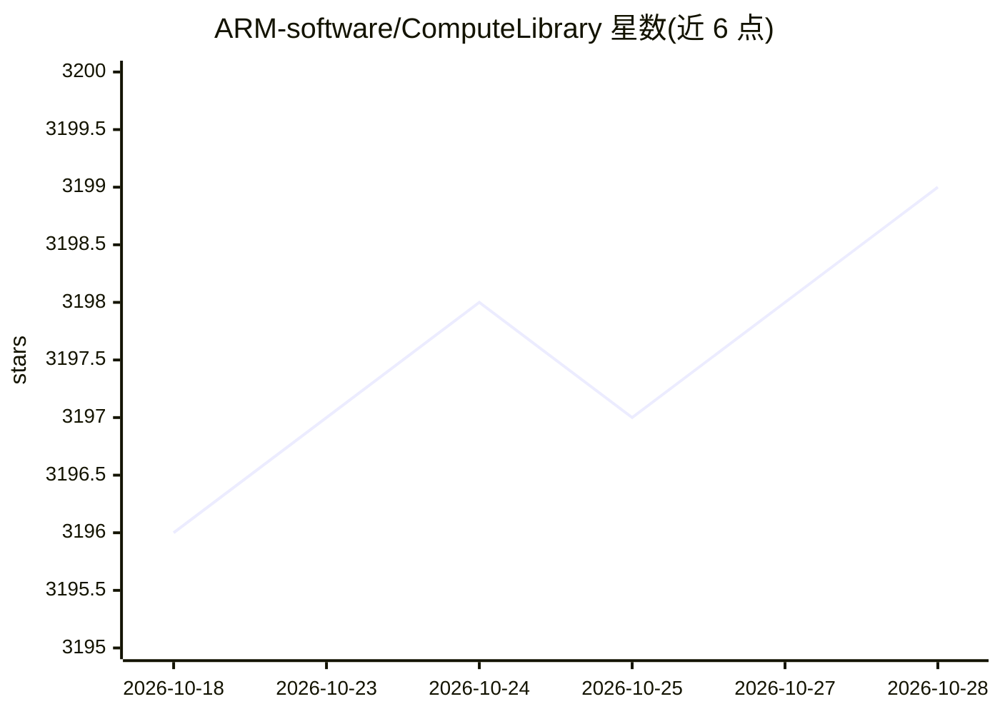

# ARM-software/ComputeLibrary

⭐ 3,200 · C++ · 推送 2026-10-28 · [GitHub](https://github.com/ARM-software/ComputeLibrary) · 组织维护

**面向 Arm CPU/GPU 优化的底层机器学习函数库**

由 Arm 维护的开源（MIT）底层机器学习函数集合，针对 Cortex-A、Neoverse CPU（Neon/SVE2）与 Mali GPU 架构优化，提供 100 余个 CPU/GPU 机器学习函数，涵盖多种卷积算法（GeMM、Winograd、FFT 等）与 FP32/FP16/INT8/BFLOAT16 等数据类型，支持内核融合、OpenCL tuner 与 GeMM 启发式调优。面向嵌入式与移动端推理场景的开发者，需在 Arm 目标平台编译或使用预编译二进制；Bazel/CMake 构建为实验性且仅支持 CPU。

## 筛选速览

| 维度 | 判定 | 备注 |
|---|---|---|
| AI 角色 | `ai-ecosystem` | LLM/agent 周边工具 |
| 许可风险 | `none` | — |
| 部署形态 | `None` |  |
| 模型依赖 | — | README 未给出锁定关系 |
| 硬件要求 | — | 无带数字的原话,不猜 |
| 安装摩擦 | `medium` | 含编译或系统依赖之一 |
| 成熟度 | `idea` | |

## 能力要点

- 100+ 个面向 Arm CPU 与 Mali GPU 的机器学习函数
- 多种卷积算法（GeMM、Winograd、FFT、Direct、indirect-GeMM）
- FP32/FP16/INT8/UINT8/BFLOAT16 多数据类型支持
- 内核融合、OpenCL tuner、GeMM 启发式等调优手段

## 适用场景

- 在 Arm 嵌入式/移动平台上构建高效的神经网络推理
- 为视觉与机器学习应用提供 Arm 架构优化的算子原语
- 利用 SVE2 等新 Arm 指令技术做微架构级优化

## 场景标签

`推理引擎` · 领域:训练与推理

## 证据(README 行号)

> L10: The Compute Library is a collection of low-level machine learning functions optimized for Arm® Cortex®-A, Arm® Neov
> L17: - Over 100 machine learning functions for CPU and GPU

## 星数曲线

2026-10-18 3,196 → 2026-10-28 3,199（+3）

---
*卡片 v1 · prompt 1.4 · 生成 2026-10-20 · 置信度 high · 依据 README sha `cc47d8ce3904` · [字段定义](../../DATASET.md)*
