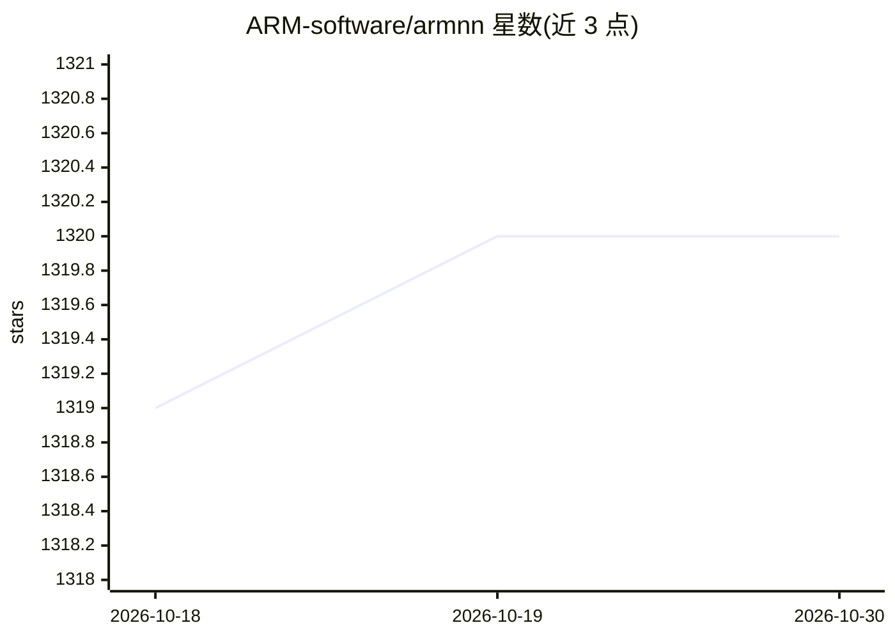

# ARM-software/armnn

⭐ 1,320 · C++ · MIT · 推送 2026-09-29 · [GitHub](https://github.com/ARM-software/armnn) · [官网](https://developer.arm.com/products/processors/machine-learning/arm-nn) · 组织维护

**面向 Arm CPU/GPU/NPU 的开源 ML 推理引擎 SDK（已停止维护）**

Arm 官方开源的 C++ 机器学习推理引擎 SDK，用于在 Arm Cortex-A CPU、Mali GPU 及 Ethos-N NPU 上加速神经网络推理，充当神经网络框架与 Arm 硬件之间的桥接层。支持 TensorFlow Lite 与 ONNX 模型格式，提供 TF Lite Delegate（Python/C++ API）、TF Lite/ONNX 解析器，以及实现 Android NNAPI HAL 的 Android NN Driver。提供预编译二进制、Debian 包和基于 Dockerfile 的构建工具。注意：项目已声明为 legacy、不再积极维护，不会再有安全补丁，官方建议仅在可信环境中使用。

## 筛选速览

| 维度 | 判定 | 备注 |
|---|---|---|
| AI 角色 | `ai-ecosystem` | LLM/agent 周边工具 |
| 许可风险 | `permissive` | MIT |
| 部署形态 | `self-host` | docker 或自建部署 |
| 模型依赖 | — | README 未给出锁定关系 |
| 硬件要求 | — | 无带数字的原话,不猜 |
| 安装摩擦 | `low` | 无编译、无系统依赖或容器化 |
| 成熟度 | — | 结构信号不足 |

## 能力要点

- 在 Arm Cortex-A CPU 与 Mali GPU 上加速 ML 推理，利用 Arm Compute Library 与 SVE2 等架构优化
- 提供 Arm NN TF Lite Delegate（Python/C++ API），不支持的算子回退到 TF Lite 参考运行时
- 支持 TensorFlow Lite 与 ONNX 模型格式，含 C++ 解析器库
- 提供 Android/Linux 预编译二进制、Debian 包与带 Dockerfile 的构建工具

## 适用场景

- 在 Android 应用中通过 TF Lite Delegate 加速我的模型推理
- 把 ONNX 或 TF Lite 模型部署到 Arm 设备上进行本地推理
- 为 Android NNAPI 集成硬件抽象层以自动加速应用内模型

## 场景标签

`推理引擎` · 领域:训练与推理

## 证据(README 行号)

> L12: **Arm NN** is the **most performant** machine learning (ML) inference engine for Android and Linux, accelerating ML
> L13: on **Arm Cortex-A CPUs and Arm Mali GPUs**. This ML inference engine is an open source SDK which bridges the gap
> L66: The Arm NN SDK supports ML models in **TensorFlow Lite** (TF Lite) and **ONNX** formats.

## 星数曲线

2026-10-18 1,319 → 2026-10-30 1,320（+1）

---
*卡片 v1 · prompt 1.4 · 生成 2026-10-21 · 置信度 high · 依据 README sha `2cf20d8ec70c` · [字段定义](../../DATASET.md)*
