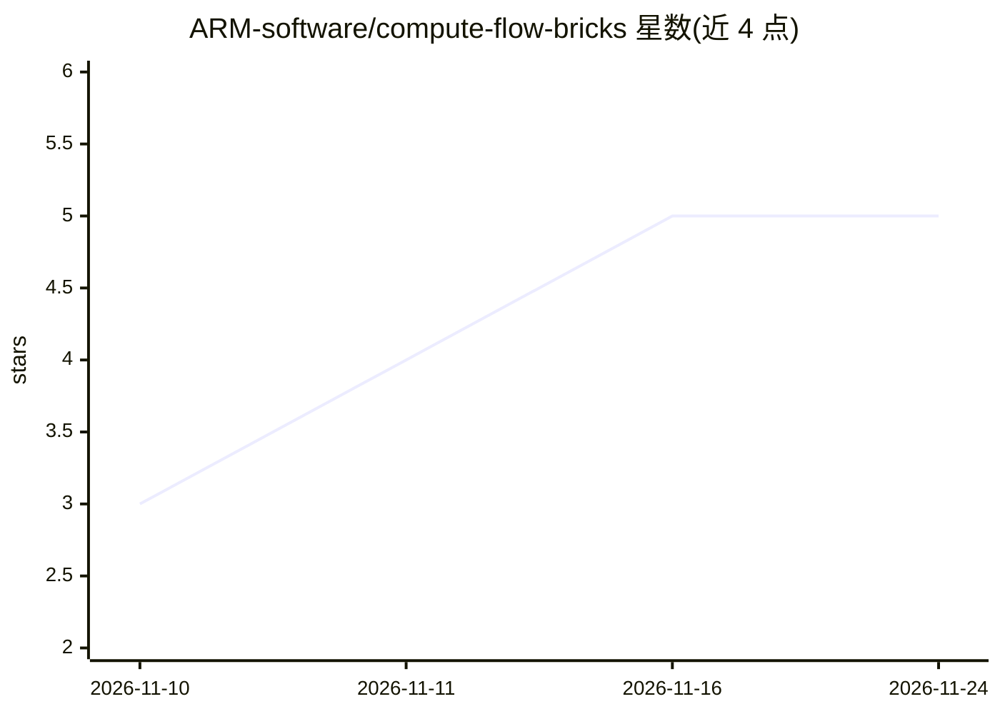

# ARM-software/compute-flow-bricks

⭐ 5 · C++ · Apache-2.0 · 推送 2026-11-10 · [GitHub](https://github.com/ARM-software/compute-flow-bricks) · 组织维护

**Arm 维护的 Compute Flow AI 可复用构件库**

Arm 维护的 Compute Flow 可复用 AI 构件集合，覆盖 TTS、STT、LLM、图像生成、深度估计、目标检测、音频分类等应用。仓库内容包含构件实现、模型元数据，以及供 Compute Flow Brick Manager 使用的源注册表。安装文档、教程与示例不在本仓库，统一维护于 Compute Flow 核心仓库，用户需前往该仓库完成安装、构建流水线或开发新构件。采用 Apache License 2.0 许可。

## 筛选速览

| 维度 | 判定 | 备注 |
|---|---|---|
| AI 角色 | `ai-ecosystem` | LLM/agent 周边工具 |
| 许可风险 | `permissive` | Apache-2.0 |
| 部署形态 | `None` |  |
| 模型依赖 | — | README 未给出锁定关系 |
| 硬件要求 | — | 无带数字的原话,不猜 |
| 安装摩擦 | `low` | 无编译、无系统依赖或容器化 |
| 成熟度 | — | 结构信号不足 |

## 能力要点

- 覆盖 TTS/STT/LLM/图像生成/深度估计/目标检测等多类 AI 构件
- 包含构件实现、模型元数据与 Brick Manager 源注册表
- 由 Arm 官方维护
- Apache License 2.0 许可

## 适用场景

- 用 Compute Flow 搭建包含语音与图像能力的 AI 流水线
- 为边缘 AI 应用查找可复用的构件实现
- 按 Brick Manager 注册表安装与管理构件

## 场景标签

`图像生成` `语音合成` `目标检测` `语音识别` · 领域:内容生成

## 证据(README 行号)

> L3: This repository contains the reusable building blocks called **bricks** maintained by Arm® for AI
> L5: includes brick implementations, model metadata, and the source registry used by the Compute Flow
> L11: Start there to install and run

## 星数曲线

2026-11-10 3 → 2026-11-24 5（+2）

---
*卡片 v1 · prompt 1.4 · 生成 2026-11-21 · 置信度 mid · 依据 README sha `2721248ffc76` · [字段定义](../../DATASET.md)*
