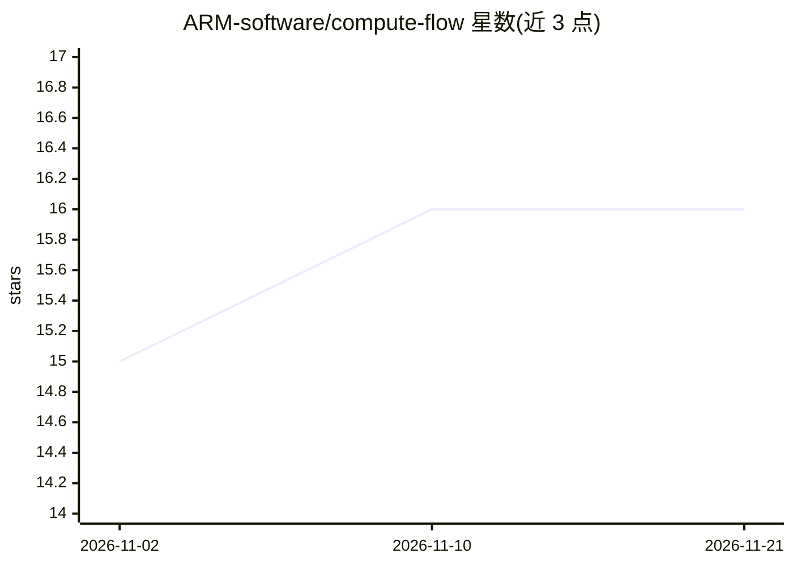

# ARM-software/compute-flow

⭐ 16 · C++ · Apache-2.0 · 推送 2026-11-19 · [GitHub](https://github.com/ARM-software/compute-flow) · 组织维护

**Arm 边缘设备端 AI 应用的 SDK：跨运行时的可复用积木式构建**

Arm 官方的端侧 AI/GenAI 应用 SDK：将 LiteRT、ExecuTorch、ONNX Runtime、llama.cpp 等推理运行时封装为可复用的构建块（bricks），使新积木无需直接依赖各运行时 API。支持 Android、Linux、macOS 目标平台，不支持微控制器。提供 Brick Manager CLI 用于发现、安装、测试积木（语音识别、语言模型、TTS、目标检测等），可将积木组合成处理管线（如音频到音频翻译），并支持从 GitHub 导入社区积木。项目处于原型阶段，API 可能变动。

## 筛选速览

| 维度 | 判定 | 备注 |
|---|---|---|
| AI 角色 | `ai-ecosystem` | LLM/agent 周边工具 |
| 许可风险 | `permissive` | Apache-2.0 |
| 部署形态 | `None` |  |
| 模型依赖 | local-ok | 支持本地模型 |
| 硬件要求 | — | 无带数字的原话,不猜 |
| 安装摩擦 | `low` | 无编译、无系统依赖或容器化 |
| 成熟度 | `idea` | |

## 能力要点

- 跨 LiteRT/ExecuTorch/ONNX Runtime/llama.cpp 运行时的统一积木抽象
- Brick Manager CLI：发现/安装/测试积木与模型包
- 支持将积木组合成 Python 处理管线（翻译、播客生成、带说话人标签转录等示例）
- 从 Git 仓库注册并安装第三方社区积木

## 适用场景

- 在 Android/Linux/macOS 端侧设备上组合积木构建 AI 管线
- 将不同推理运行时的模型封装为可复用积木并分享给社区
- 用命令行安装 Qwen3-TTS 等积木并运行 C++/Python CLI 示例

## 场景标签

 · 领域:端侧/边缘 AI 开发框架

## 证据(README 行号)

> L3: Compute Flow is an SDK for building AI and GenAI applications from reusable building blocks called
> L6: Compute Flow brings together inference runtimes such as LiteRT, ExecuTorch, ONNX Runtime, and
> L8: designed for Arm® edge AI inference across platforms, including **Android™**, **Linux®**, and

## 星数曲线

2026-11-02 15 → 2026-11-21 16（+1）

---
*卡片 v1 · prompt 1.4 · 生成 2026-11-18 · 置信度 high · 依据 README sha `5a7e17650e6a` · [字段定义](../../DATASET.md)*
