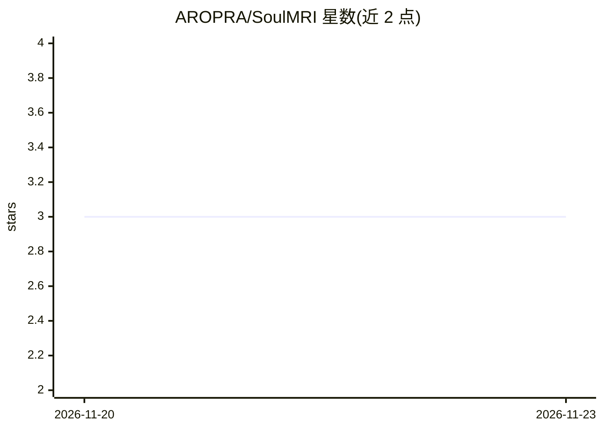

# AROPRA/SoulMRI

⭐ 3 · MIT · 推送 2026-11-16 · [GitHub](https://github.com/AROPRA/SoulMRI) · [官网](https://aropra.github.io/SoulMRI/) · 组织维护 · 中文 README

**供 agent 使用的角色卡提取 skill：从已有材料第一人称提取人格**

一个以 SKILL.md 形式分发的 skill 文件夹，用于指导模型把角色卡写作从「创作」转为「提取」：全程第一人称、每句话带出处或标记为虚构、末尾对未知留白。按材料分为四条路径（完整文本、网络资料、从零原创、真人聊天记录），其中真人聊天记录产出 echo（回声）而非传记。仓库含凯伊、小满、栀子梦三个示例及源聊天记录、流程图与结构化导出的 extractor 说明。skill 本体无需安装或编译，无脚本依赖。

## 筛选速览

| 维度 | 判定 | 备注 |
|---|---|---|
| AI 角色 | `ai-native` | 本体是模型或模型工具 |
| 许可风险 | `permissive` | MIT |
| 部署形态 | `None` |  |
| 模型依赖 | — | README 未给出锁定关系 |
| 硬件要求 | — | 无带数字的原话,不猜 |
| 安装摩擦 | `low` | 无编译、无系统依赖或容器化 |
| 成熟度 | — | 结构信号不足 |

## 能力要点

- 第一人称、每句带出处的提取式角色卡写作规范
- 真人聊天记录走 echo 路径：回答但不代人物继续生长
- 十个固定小节结构 + 末尾留白规则
- 示例成品、源聊天记录对与 extractor 说明随仓库提供

## 适用场景

- 从已有的完整文本或网络资料中提取角色的人格卡
- 基于真人聊天记录制作回声型（echo）角色文件
- 给 agent 框架添加一套角色卡生成的 skill

## 场景标签

`提示工程` · 领域:Agent 开发

## 证据(README 行号)

> L54: A skill is a folder with a `SKILL.md` in it. Put this one where your agent looks for skills, or paste `SKILL.md` in
> L61: Keep `SKILL.md`, `references/` and — if you want the demonstrations — `examples/` together. The references are read

## 星数曲线

2026-11-20 3 → 2026-11-23 3（+0）

---
*卡片 v1 · prompt 1.4 · 生成 2026-11-22 · 置信度 high · 依据 README sha `39e431b5bbd3` · [字段定义](../../DATASET.md)*
