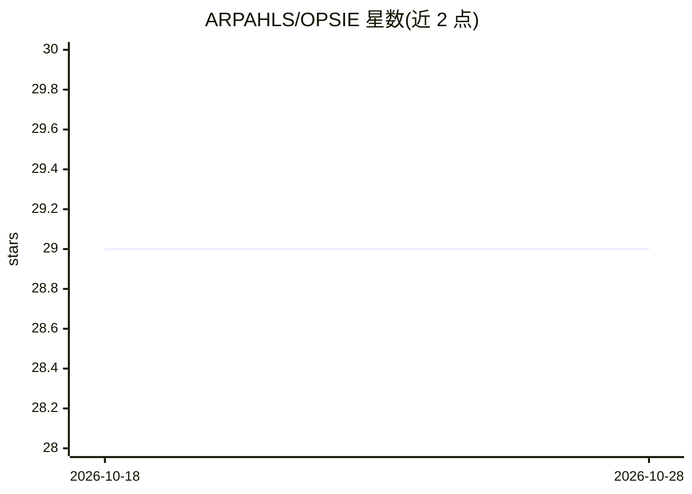

# ARPAHLS/OPSIE

⭐ 29 · Python · NOASSERTION · 推送 2026-05-21 · [GitHub](https://github.com/ARPAHLS/OPSIE) · [官网](https://arpacorp.net) · 组织维护

**本地多模型终端人格代理：带记忆、多模态与 Web3/邮件等工具**

OPSIIE 是一个单文件的终端原生自中心智能（SCI）原型：长会话中与本地 Ollama 模型对话，用 PostgreSQL 存储持久对话记忆、ChromaDB 做语义召回，并集成 URL/文件富化、图像/音乐/视频生成、市场行情、自然语言加密转账、SMTP/IMAP 邮件、DNA 序列流水线与多代理房间等斜杠命令。启动含面部/情绪识别门控与权限分级（arpa_id 以 R 开头为主控）。面向想研究代理编排与记忆或将其作为个人操作员的用户。需 Python 3.8+、PostgreSQL 14+、Ollama 0.3+、ChromaDB 0.4+，摄像头麦克风用于默认认证与语音；Windows 为主要测试平台。

## 筛选速览

| 维度 | 判定 | 备注 |
|---|---|---|
| AI 角色 | `ai-native` | 本体是模型或模型工具 |
| 许可风险 | `none` | NOASSERTION |
| 部署形态 | `library` | 以包/库形式分发 |
| 模型依赖 | local-ok | 支持本地模型 |
| 硬件要求 | — | 无带数字的原话,不猜 |
| 安装摩擦 | `low` | 无编译、无系统依赖或容器化 |
| 成熟度 | — | 结构信号不足 |

## 能力要点

- PostgreSQL 持久记忆 + ChromaDB 语义召回的 agentic RAG 会话
- 内置图像/音乐/视频生成、市场行情、Web3 转账、邮件读写、DNA 流水线等命令
- 面部与情绪识别启动门控及 arpa_id 权限分级
- 启动流程含模型探测、传感器检查、多代理网络探测等十余个阶段

## 适用场景

- 在本地模型上运行一个带长期记忆的个人终端助手
- 研究代理编排、记忆与 RAG 机制的构建方式
- 在一个会话里完成对话、生成媒体、查行情、收发邮件等操作

## 场景标签

 · 领域:终端 AI 代理/个人助手

## 证据(README 行号)

> L16: OPSIE is a **terminal personality with agency and memory** that can act as a **daily driver assistant for technical
> L40: **OPSIE** (ΌΨΗ—the Greek *opsis*: view, angle, perspective, the read you take on something) is a terminal-native **

## 星数曲线

2026-10-18 29 → 2026-10-28 29（+0）

---
*卡片 v1 · prompt 1.4 · 生成 2026-10-26 · 置信度 high · 依据 README sha `0b2d41d4abf1` · [字段定义](../../DATASET.md)*
