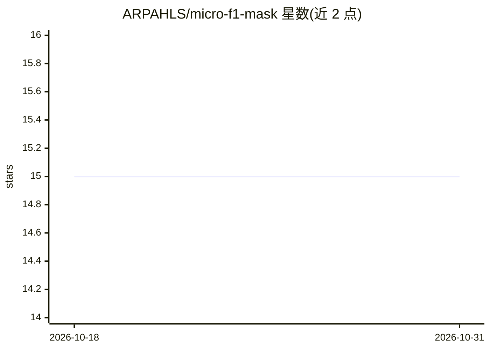

# ARPAHLS/micro-f1-mask

⭐ 15 · Python · Apache-2.0 · 推送 2026-04-06 · [GitHub](https://github.com/ARPAHLS/micro-f1-mask) · [官网](https://huggingface.co/arpacorp/micro-f1-mask) · 组织维护

**拦截 LLM 出站提示词并检测/标记化 PII 的隐私中间件**

ARPA Micro Series F1 Mask 是面向企业云端合规的 PII 清洗中间件：以 FastAPI 代理拦截发往云端 LLM API 的提示词，用 270M 参数模型检测 6 类 PII 实体（个人/财务/位置/联系/凭证/公司）并替换为令牌，敏感原文存于 Redis Vault（按 session_id 隔离、幂等映射、TTL 默认 2 小时），仅净化内容出站。模型通过 Ollama 注册并本地运行，附带合成数据生成器与 LoRA 微调流水线。公开版为 1,000 样本规模的原型，README 说明达到 95%+ 企业精度需自行扩量重训，另提供付费企业版。

## 筛选速览

| 维度 | 判定 | 备注 |
|---|---|---|
| AI 角色 | `ai-native` | 本体是模型或模型工具 |
| 许可风险 | `permissive` | Apache-2.0 |
| 部署形态 | `self-host` | docker 或自建部署 |
| 模型依赖 | local-ok | 支持本地模型 |
| 硬件要求 | — | 无带数字的原话,不猜 |
| 安装摩擦 | `low` | 无编译、无系统依赖或容器化 |
| 成熟度 | `idea` | |

## 能力要点

- 270M 参数模型检测 6 类 PII 实体并令牌化
- Redis Vault 会话级映射：幂等、按 session 隔离、可配置 TTL
- 模型经 Ollama 本地注册运行，支持 4-bit 量化
- 提供合成训练数据生成器与 LoRA 微调流水线

## 适用场景

- 企业将提示词中的 PII 净化后再调用云端 LLM API
- 多轮对话中保持同一 PII 值映射到同一令牌
- 用自有行业数据重新训练以提升检测精度

## 场景标签

`网络安全` `微调` · 领域:学习与行业

## 证据(README 行号)

> L22: ARPA Micro Series: F1 Mask is a purpose-built privacy bridge designed to intercept outgoing LLM prompts, detect and
> L114: F1 Mask detects and tokenizes 6 core entity categories:
> L146: 2. **Minimalist Scope**: 270M parameters focused strictly on scrubbing, avoiding general-purpose LLM risks.

## 星数曲线

2026-10-18 15 → 2026-10-31 15（+0）

---
*卡片 v1 · prompt 1.4 · 生成 2026-10-31 · 置信度 mid · 依据 README sha `b62dfa5bf57b` · [字段定义](../../DATASET.md)*
