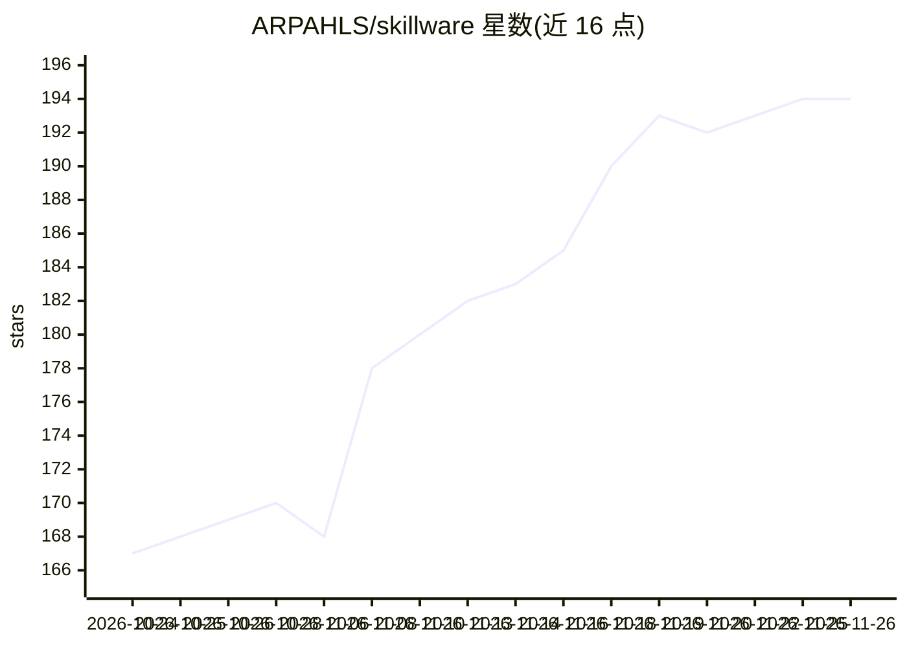

# ARPAHLS/skillware

⭐ 194 · Python · MIT · 推送 2026-11-25 · [GitHub](https://github.com/ARPAHLS/skillware) · [官网](http://skillware.site) · 组织维护

**为 AI agent 安装模块化技能的 Python 框架与注册表**

Skillware 将 agent 能力打包为自包含 Skill（代码、契约、宿主指令、离线测试），加载后适配到 Gemini/Claude/OpenAI/Ollama 等 OpenAI 兼容宿主的工具格式，应用自身运行 agent 循环。通过 SkillContext 的渐进式披露在运行时按需挂载技能说明，并内置凭据隔离、AST 审计等安全机制。以 Python 库形式发布到 PyPI，附 CLI、文档与各分类技能的 pip extras。

## 筛选速览

| 维度 | 判定 | 备注 |
|---|---|---|
| AI 角色 | `ai-ecosystem` | LLM/agent 周边工具 |
| 许可风险 | `permissive` | MIT |
| 部署形态 | `library` | 以包/库形式分发 |
| 模型依赖 | local-ok | 支持本地模型 |
| 硬件要求 | — | 无带数字的原话,不猜 |
| 安装摩擦 | `low` | 无编译、无系统依赖或容器化 |
| 成熟度 | — | 结构信号不足 |

## 能力要点

- Skill 含契约/Effect 代码/指令/保障测试/接口五部分，版本化软件模块形式
- 适配 Gemini、Claude、OpenAI、Ollama 及 OpenAI 兼容宿主
- JIT 渐进式披露按需挂载技能说明以减少提示词冗余
- CLI 提供 list/paths/config/doctor 等命令，技能按分类以 pip extras 安装

## 适用场景

- 为自建 agent 应用接入可复用的领域技能包
- 在多个模型宿主间复用同一套工具能力定义
- 需要确定性、可审计工具执行的企业工作流

## 场景标签

`Agent 框架` · 领域:Agent 开发

## 证据(README 行号)

> L24: **Skillware** is an open-source framework and registry for modular, actionable Agent capabilities. It installs know
> L30: Every new agent stack tends to reinvent tool schemas, system prompts, and safety rules. **Skillware** packages each
> L50:     Registry[Registry] -->|Load| Loader[Loader]

## 星数曲线

2026-10-24 167 → 2026-11-26 194（+27）

---
*卡片 v1 · prompt 1.4 · 生成 2026-11-25 · 置信度 high · 依据 README sha `ba1fbff60b2e` · [字段定义](../../DATASET.md)*
