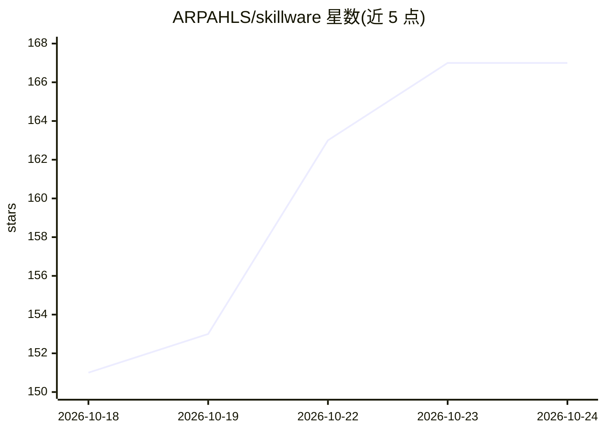

# ARPAHLS/skillware

⭐ 168 · Python · MIT · 推送 2026-10-24 · [GitHub](https://github.com/ARPAHLS/skillware) · [官网](http://skillware.site) · 组织维护

**给 AI agent 安装模块化技能包的 Python 框架与注册表**

Skillware 是一个开源 Python 框架与技能注册表，把 agent 能力打包为自包含的 Skill 束（含 Contract 安全边界与类型化 I/O、可执行 Python 的 Effect、系统指令 Directive、离线测试 Assurance、标准化工具 Interface），由 SkillLoader 加载并适配到 Gemini、Claude、OpenAI、Ollama 等 OpenAI 兼容宿主。内置 12 个类别共约 27 个捆绑技能，经 pip 安装，每技能有独立 pip extra；要求 Python 3.10+。作者自述与 MCP、Agent Skills（SKILL.md）在模型无关、代码优先、运行时聚焦上有差异。

## 筛选速览

| 维度 | 判定 | 备注 |
|---|---|---|
| AI 角色 | `ai-ecosystem` | LLM/agent 周边工具 |
| 许可风险 | `permissive` | MIT |
| 部署形态 | `library` | 以包/库形式分发 |
| 模型依赖 | local-ok | 支持本地模型 |
| 硬件要求 | — | 无带数字的原话,不猜 |
| 安装摩擦 | `low` | 无编译、无系统依赖或容器化 |
| 成熟度 | — | 结构信号不足 |

## 能力要点

- Skill 束五要素：Contract/Effect/Directive/Assurance/Interface
- SkillLoader 将技能适配为 Gemini/Claude/OpenAI/Ollama 工具格式
- 内置 12 类捆绑技能（数据工程、合规、DeFi、办公等），每技能有 pip extra
- 提供 CLI（skillware list/paths/config）与技能链（SkillContext chains）

## 适用场景

- 为我的 Gemini/Claude/Ollama agent 附加 Gmail 等可执行技能
- 以标准化工具 schema 方式管理 agent 能力而非反复写提示词
- 在多个 LLM 宿主间复用同一套技能包

## 场景标签

`Agent 框架` · 领域:Agent 开发

## 证据(README 行号)

> L23: **Skillware** is an open-source framework and registry for modular, actionable Agent capabilities. It installs know
> L29: Every new agent stack tends to reinvent tool schemas, system prompts, and safety rules. **Skillware** packages each
> L53: Install the registry once. Skillware loads a bundle, adapts it to your host's tool format, and your app runs the ag

## 星数曲线

2026-10-18 151 → 2026-10-24 167（+16）

---
*卡片 v1 · prompt 1.4 · 生成 2026-10-22 · 置信度 high · 依据 README sha `0dd08af48895` · [字段定义](../../DATASET.md)*
