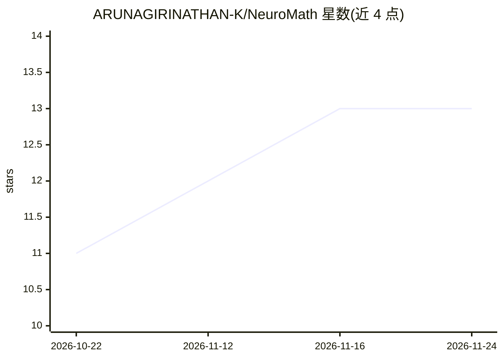

# ARUNAGIRINATHAN-K/NeuroMath

⭐ 13 · Jupyter Notebook · MIT · 推送 2026-11-14 · [GitHub](https://github.com/ARUNAGIRINATHAN-K/NeuroMath) · 个人维护

**用纯 NumPy 从零实现神经网络数学原理的教学代码库**

以纯 Python 与 NumPy 从第一性原理实现前馈网络、反向传播与梯度下降，不依赖 autograd 框架。包含 10 个解耦模块，覆盖 XOR 分类、MNIST 多分类、损失景观可视化、dropout 正则化与时间序列回归；梯度为手工推导的解析雅可比，并附带数学理论指南 PDF。安装仅需 Python 3.10+ 与 requirements.txt 中的 numpy/matplotlib 等依赖，面向学习神经网络数学机制的开发者与学生。

## 筛选速览

| 维度 | 判定 | 备注 |
|---|---|---|
| AI 角色 | `ai-knowledge` | 知识聚合/清单类 |
| 许可风险 | `permissive` | MIT |
| 部署形态 | `library` | 以包/库形式分发 |
| 模型依赖 | — | README 未给出锁定关系 |
| 硬件要求 | — | 无带数字的原话,不猜 |
| 安装摩擦 | `medium` | 含编译或系统依赖之一 |
| 成熟度 | — | 结构信号不足 |

## 能力要点

- 手工推导反向传播与解析梯度，零依赖 autograd
- 10 个独立教学模块，从 XOR 到时间序列 ANN
- 2D/3D 损失景观与激活函数饱和分析工具
- 附带数学理论手册 Mathematics_of_ANN.pdf

## 适用场景

- 从数学层面理解反向传播与梯度更新的推导过程
- 在教学或课程作业中运行可逐步检查的神经网络实现
- 可视化损失曲面、鞍点与局部极小值

## 场景标签

`教程课程` · 领域:学习与行业

## 证据(README 行号)

> L3: **The mathematical engine of neural networks, engineered from first principles in pure Python and NumPy.**
> L29: * **Companion Theory Included**: Ships with an in-depth companion mathematical guide (`Mathematics_of_ANN.pdf`) cov
> L116:  - [x] 10 standalone educational modules covering XOR to time series.

## 星数曲线

2026-10-22 11 → 2026-11-24 13（+2）

---
*卡片 v1 · prompt 1.4 · 生成 2026-11-18 · 置信度 high · 依据 README sha `96ff44e77d2c` · [字段定义](../../DATASET.md)*
