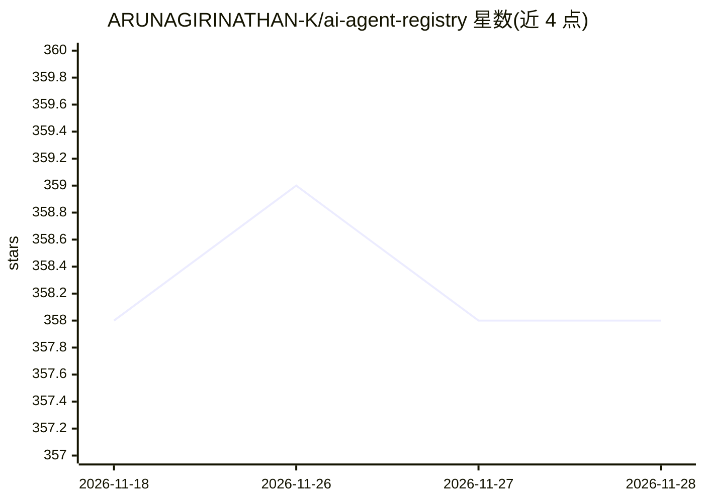

# ARUNAGIRINATHAN-K/ai-agent-registry

⭐ 358 · TypeScript · NOASSERTION · 推送 2026-11-27 · [GitHub](https://github.com/ARUNAGIRINATHAN-K/ai-agent-registry) · [官网](https://openagentregistry.vercel.app/) · 个人维护

**开源 AI Agent 发现目录：检索比较 500+ 智能体与框架**

社区驱动的 AI Agent 生态目录，以 Next.js 14 交互式 Web 应用呈现，收录 500+ 个 agent、框架、工具、技能与基础设施条目，按 32 个类别组织，支持搜索、筛选与浏览。条目通过 Web 提交门户或 GitHub Issue 表单由社区贡献，数据经构建脚本生成，部署方式覆盖本地 npm 运行、Docker Compose 与 Vercel 一键部署，并提供在线注册表站点。

## 筛选速览

| 维度 | 判定 | 备注 |
|---|---|---|
| AI 角色 | `ai-knowledge` | 知识聚合/清单类 |
| 许可风险 | `none` | NOASSERTION |
| 部署形态 | `self-host` | docker 或自建部署 |
| 模型依赖 | — | README 未给出锁定关系 |
| 硬件要求 | — | 无带数字的原话,不猜 |
| 安装摩擦 | `low` | 无编译、无系统依赖或容器化 |
| 成熟度 | — | 结构信号不足 |

## 能力要点

- 收录 500+ AI agent/框架/工具条目，覆盖 32 个类别
- Next.js 14 交互式 Web 应用支持搜索与筛选
- 提供 Web 门户与 GitHub Issue 两种社区提交入口
- 支持本地、Docker Compose、Vercel 三种运行/部署方式

## 适用场景

- 为项目选型时检索和比较可用的 agent 框架
- 浏览 AI agent 生态各分类下的工具清单
- 把自己维护的 agent 项目提交收录进目录

## 场景标签

`精选清单` · 领域:学习与行业

## 证据(README 行号)

> L12: **Discover, compare, and explore 500+ AI agents, frameworks, tools, skills, and infrastructure across 32 categories
> L14: AI Agent Registry is an open-source, community-driven directory designed to make the rapidly growing AI agent ecosy

## 星数曲线

2026-11-18 358 → 2026-11-28 358（+0）

---
*卡片 v1 · prompt 1.4 · 生成 2026-11-28 · 置信度 high · 依据 README sha `f9f369e94205` · [字段定义](../../DATASET.md)*
