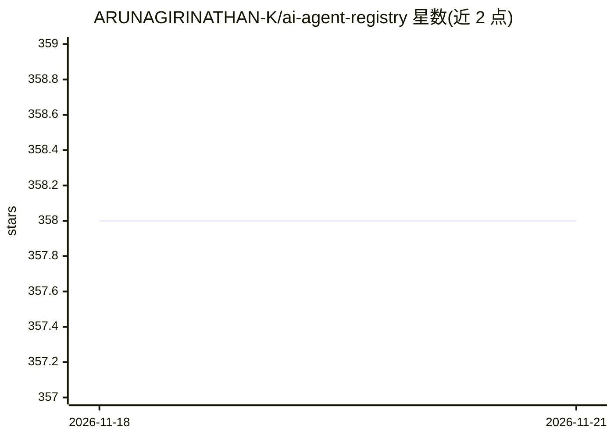

# ARUNAGIRINATHAN-K/ai-agent-registry

⭐ 358 · TypeScript · NOASSERTION · 推送 2026-11-17 · [GitHub](https://github.com/ARUNAGIRINATHAN-K/ai-agent-registry) · [官网](https://ai-agent-registry-kappa.vercel.app) · 个人维护

**AI Agent 生态策展目录：500+ 智能体与框架的分类检索**

社区驱动的开源目录项目，收录 500+ AI agent、框架、工具、技能与基础设施条目，按 32 个类别组织，覆盖编排框架、编码智能体等。提供 Next.js 14 交互式检索应用（支持搜索与过滤），可本地运行（npm / Docker）或一键部署到 Vercel，并有线上注册表；条目通过 Web 提交门户或 GitHub Issue 表单贡献。README 以分类清单为主体，逐条列出项目名称、语言标签与一句描述。

## 筛选速览

| 维度 | 判定 | 备注 |
|---|---|---|
| AI 角色 | `ai-knowledge` | 知识聚合/清单类 |
| 许可风险 | `none` | NOASSERTION |
| 部署形态 | `self-host` | docker 或自建部署 |
| 模型依赖 | — | README 未给出锁定关系 |
| 硬件要求 | — | 无带数字的原话,不猜 |
| 安装摩擦 | `low` | 无编译、无系统依赖或容器化 |
| 成熟度 | — | 结构信号不足 |

## 能力要点

- 收录 500+ 条目、32 个类别的社区驱动目录
- Next.js 14 交互式检索应用，支持搜索与过滤
- 提供 Web 提交门户与 GitHub Issue 无代码提交通道
- 支持 Docker 与 Vercel 一键部署

## 适用场景

- 查找和比较 AI agent 框架与编码智能体工具
- 为自己的 agent 项目提交收录曝光
- 了解 AI agent 生态的工具覆盖与分类结构

## 场景标签

`精选清单` · 领域:学习与行业

## 证据(README 行号)

> L12: **Discover, compare, and explore 500+ AI agents, frameworks, tools, skills, and infrastructure across 32 categories
> L14: AI Agent Registry is an open-source, community-driven directory designed to make the rapidly growing AI agent ecosy
> L22: Interactive Next.js 14 web application for searching, filtering, and exploring AI agents, frameworks, and infrastru

## 星数曲线

2026-11-18 358 → 2026-11-21 358（+0）

---
*卡片 v1 · prompt 1.4 · 生成 2026-11-18 · 置信度 high · 依据 README sha `5fac7811434e` · [字段定义](../../DATASET.md)*
