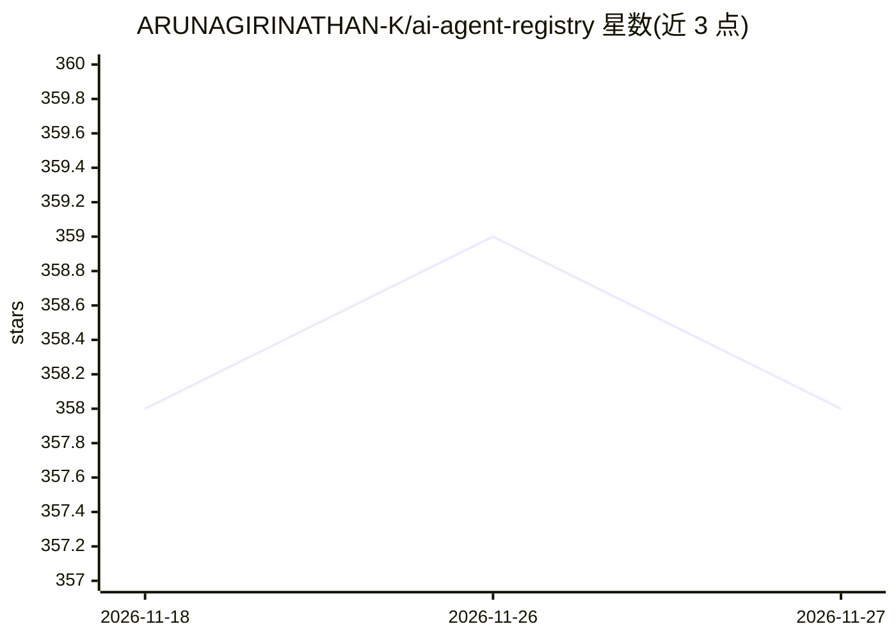

# ARUNAGIRINATHAN-K/ai-agent-registry

⭐ 358 · TypeScript · NOASSERTION · 推送 2026-11-25 · [GitHub](https://github.com/ARUNAGIRINATHAN-K/ai-agent-registry) · [官网](https://ai-agent-registry-kappa.vercel.app) · 个人维护

**社区驱动的 AI Agent 发现与编目平台（500+ 条目）**

以 Next.js 14 Web 应用形式提供的开源 AI Agent 目录，收录 500+ 个 agent、框架、工具、技能与基础设施条目，按 32 个类别组织，支持搜索与过滤浏览。数据经 npm run build:data 生成，支持本地运行、Docker 部署与 Vercel 一键部署，通过 Web 表单或 GitHub Issue 提交新条目，数据模式公开，以 CC0 许可发布。

## 筛选速览

| 维度 | 判定 | 备注 |
|---|---|---|
| AI 角色 | `ai-knowledge` | 知识聚合/清单类 |
| 许可风险 | `none` | NOASSERTION |
| 部署形态 | `self-host` | docker 或自建部署 |
| 模型依赖 | — | README 未给出锁定关系 |
| 硬件要求 | — | 无带数字的原话,不猜 |
| 安装摩擦 | `low` | 无编译、无系统依赖或容器化 |
| 成熟度 | — | 结构信号不足 |

## 能力要点

- 收录 500+ agent/框架/工具条目，覆盖 32 个类别
- Next.js 14 交互式 Web 注册表，支持搜索与过滤
- 支持 Web 表单与 GitHub Issue 两种条目提交途径
- 提供 Docker Compose 与 Vercel 一键部署

## 适用场景

- 按类别浏览和比较 AI agent 框架
- 为项目寻找合适的 agent 工具或基础设施
- 向社区提交自己的 agent 项目供收录

## 场景标签

`精选清单` · 领域:学习与行业

## 证据(README 行号)

> L12: **Discover, compare, and explore 500+ AI agents, frameworks, tools, skills, and infrastructure across 32 categories
> L14: AI Agent Registry is an open-source, community-driven directory designed to make the rapidly growing AI agent ecosy
> L22: Interactive Next.js 14 web application for searching, filtering, and exploring AI agents, frameworks, and infrastru

## 星数曲线

2026-11-18 358 → 2026-11-27 358（+0）

---
*卡片 v1 · prompt 1.4 · 生成 2026-11-26 · 置信度 high · 依据 README sha `137d38b9156f` · [字段定义](../../DATASET.md)*
