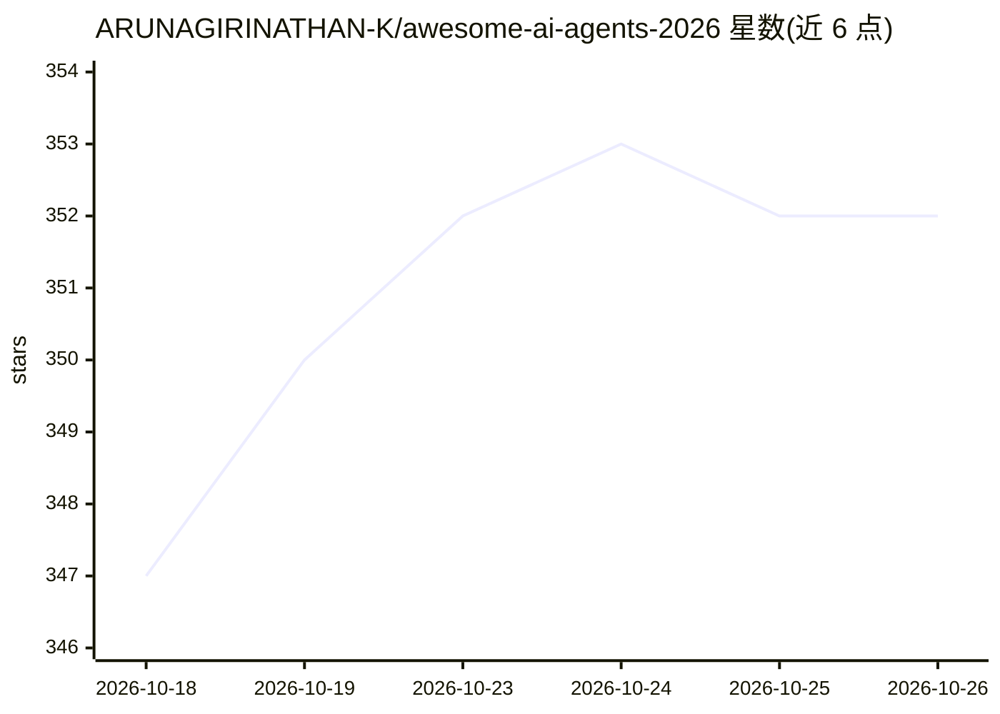

# ARUNAGIRINATHAN-K/awesome-ai-agents-2026

⭐ 352 · TypeScript · NOASSERTION · 推送 2026-10-23 · [GitHub](https://github.com/ARUNAGIRINATHAN-K/awesome-ai-agents-2026) · [官网](https://ai-agent-registry-kappa.vercel.app) · 个人维护

**AI agent 框架与工具的策展清单，附带可搜索 Web 注册表**

按编排框架、编码 agent、记忆与上下文等类别组织的 AI agent 资源清单，条目标注语言、类别与简介；同时提供 Next.js 14 的 Registry Explorer Web 应用，支持搜索、过滤和浏览条目，可通过 npm、Docker 或 Vercel 部署，并提供 Web 提交门户与 GitHub Issue 表单两种收录渠道，宣称每周更新、条目附星数与 PR 对比信息。面向挑选 agent 框架与工具的开发者。

## 筛选速览

| 维度 | 判定 | 备注 |
|---|---|---|
| AI 角色 | `ai-knowledge` | 知识聚合/清单类 |
| 许可风险 | `none` | NOASSERTION |
| 部署形态 | `self-host` | docker 或自建部署 |
| 模型依赖 | — | README 未给出锁定关系 |
| 硬件要求 | — | 无带数字的原话,不猜 |
| 安装摩擦 | `low` | 无编译、无系统依赖或容器化 |
| 成熟度 | — | 结构信号不足 |

## 能力要点

- 按编排框架/编码 agent/记忆等类别组织的结构化清单
- Next.js 14 Registry Explorer 支持搜索过滤与本地部署
- 提供 Web 门户与 GitHub Issue 表单两种条目提交渠道
- Vercel 一键部署与 docker compose 本地运行

## 适用场景

- 按类别查找和比较 AI agent 编排框架
- 搜索适合自己技术栈的编码 agent 工具
- 提交自己的 agent 项目到清单收录

## 场景标签

`精选清单` · 领域:学习与行业

## 证据(README 行号)

> L12: *The most comprehensive, structured guide to AI agent frameworks, tools, and resources.*
> L21: Interactive Next.js 14 web application for searching, filtering, and exploring AI agents, frameworks, and infrastru

## 星数曲线

2026-10-18 347 → 2026-10-26 352（+5）

---
*卡片 v1 · prompt 1.4 · 生成 2026-10-22 · 置信度 high · 依据 README sha `9a7e2015e267` · [字段定义](../../DATASET.md)*
