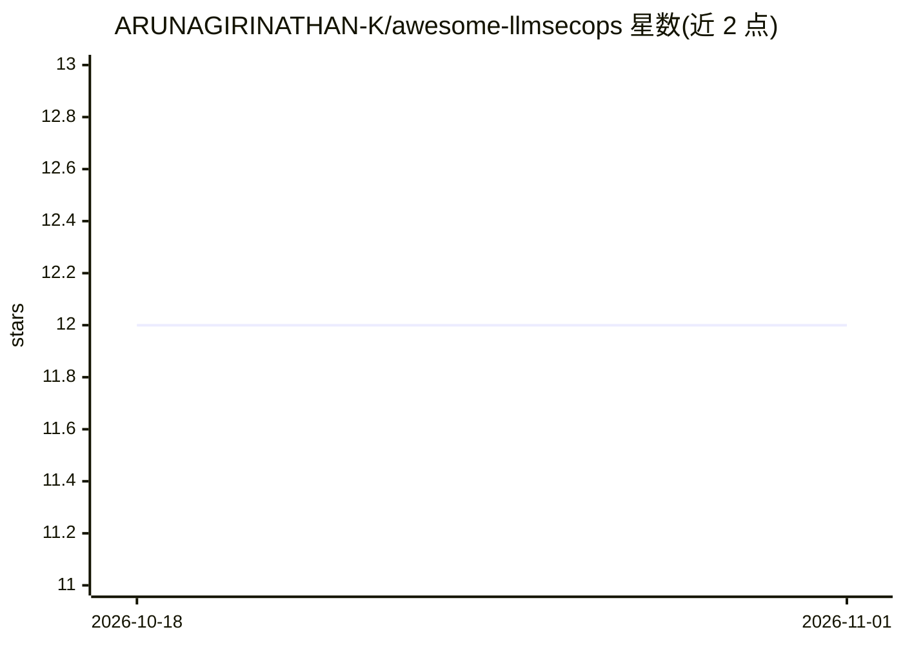

# ARUNAGIRINATHAN-K/awesome-llmsecops

⭐ 12 · MIT · 推送 2026-10-05 · [GitHub](https://github.com/ARUNAGIRINATHAN-K/awesome-llmsecops) · 个人维护

**LLM 安全运维（LLMSecOps）策展清单：覆盖 AI 全生命周期安全资源**

面向安全工程师、ML/AI 工程师、平台/DevOps 工程师、安全研究者与企业架构师/CISO 的 LLM 安全资源清单。按 LLMSecOps 生命周期（设计、开发训练、部署、运营、监控等阶段）组织，收录威胁建模、合规治理（EU AI Act、NIST AI RMF、ISO/IEC 42001）、模型安全与训练完整性、供应链安全等类别的工具、框架、研究论文与学习资源，并为不同角色提供 Quick Start 指引。条目仅含名称与一句话描述，可见部分未给出具体安装方式。

## 筛选速览

| 维度 | 判定 | 备注 |
|---|---|---|
| AI 角色 | `ai-knowledge` | 知识聚合/清单类 |
| 许可风险 | `permissive` | MIT |
| 部署形态 | `None` |  |
| 模型依赖 | — | README 未给出锁定关系 |
| 硬件要求 | — | 无带数字的原话,不猜 |
| 安装摩擦 | `low` | 无编译、无系统依赖或容器化 |
| 成熟度 | — | 结构信号不足 |

## 能力要点

- 按 LLMSecOps 生命周期阶段组织资源条目
- 覆盖威胁建模、合规治理、模型安全、供应链安全等类别
- 为 5 类角色（安全工程师/ML 工程师/DevOps/研究者/CISO）提供分角色入门指引

## 适用场景

- 查找 LLM 应用安全防护与红队测试工具
- 了解 AI 合规法规与治理框架（EU AI Act、NIST AI RMF 等）
- 追踪 LLM 安全方向的研究论文与学习资源

## 场景标签

`精选清单` `网络安全` · 领域:学习与行业

## 证据(README 行号)

> L17: *A curated list of tools, frameworks, research, and best practices for securing Large Language Model and Generative
> L38: LLMSecOps is a new discipline integrating cybersecurity throughout the entire lifecycle of Large Language Model (LL

## 星数曲线

2026-10-18 12 → 2026-11-01 12（+0）

---
*卡片 v1 · prompt 1.4 · 生成 2026-11-01 · 置信度 high · 依据 README sha `d9d2e70df449` · [字段定义](../../DATASET.md)*
