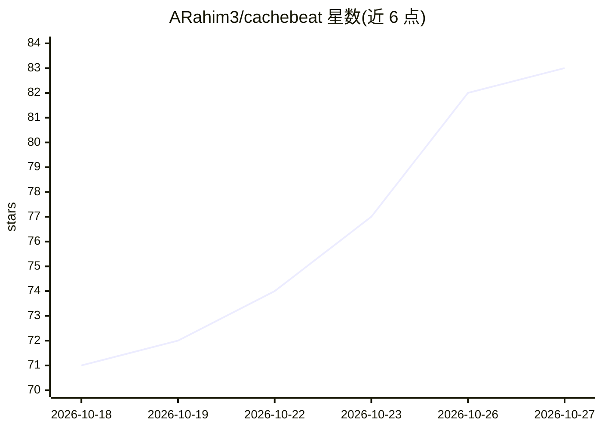

# ARahim3/cachebeat

⭐ 83 · Shell · MIT · 推送 2026-10-13 · [GitHub](https://github.com/ARahim3/cachebeat) · 个人维护

**保持 Claude Code 会话提示缓存温热的小技能，降低闲置后返回成本**

由两个文件（SKILL.md 与 beat.sh）组成的 Claude Code 技能：通过 frontmatter 声明的 asyncRewake Stop 钩子，在会话闲置 N 分钟（默认 50，可设 5–55）后触发一次心跳，让 Claude 以缓存读取方式唤醒并回复单句，重置缓存 TTL，避免整段历史按全价重计。默认 8 小时后自动停止；若检测到缓存已过期或 5 分钟 TTL 会话则自行停止。安装为复制文件到 ~/.claude/skills 或项目 .claude/skills，需启用 hooks 的较新 Claude Code。兼容 Linux、WSL2、macOS，原生 Windows 未测试。

## 筛选速览

| 维度 | 判定 | 备注 |
|---|---|---|
| AI 角色 | `ai-ecosystem` | LLM/agent 周边工具 |
| 许可风险 | `permissive` | MIT |
| 部署形态 | `None` |  |
| 模型依赖 | locked-api |  |
| 硬件要求 | — | 无带数字的原话,不猜 |
| 安装摩擦 | `low` | 无编译、无系统依赖或容器化 |
| 成熟度 | — | 结构信号不足 |

## 能力要点

- 基于 Stop hook + asyncRewake 的非活跃计时器，仅真正闲置时触发
- 默认 50 分钟阈值（可调 5–55）、8 小时自动停止
- 每次心跳自审计 cache_creation，缓存已冷则停止并告知
- 仅用 tail/grep/sed 等可移植工具，兼容 bash/dash/ksh

## 适用场景

- 长时间训练/CI 任务旁的 Claude 会话闲置后低成本恢复
- 减少 API 计费或订阅 5 小时窗口被冷启动消耗
- 多天长会话中维持缓存温热

## 场景标签

 · 领域:LLM 开发者工具/成本优化

## 证据(README 行号)

> L5: A tiny Claude Code skill that keeps your prompt cache warm while a session sits idle — so your
> L117: The skill's frontmatter declares a **Stop hook** with `asyncRewake: true`. Claude Code registers it when

## 星数曲线

2026-10-18 71 → 2026-10-27 83（+12）

---
*卡片 v1 · prompt 1.4 · 生成 2026-10-24 · 置信度 high · 依据 README sha `f4b7507926ef` · [字段定义](../../DATASET.md)*
