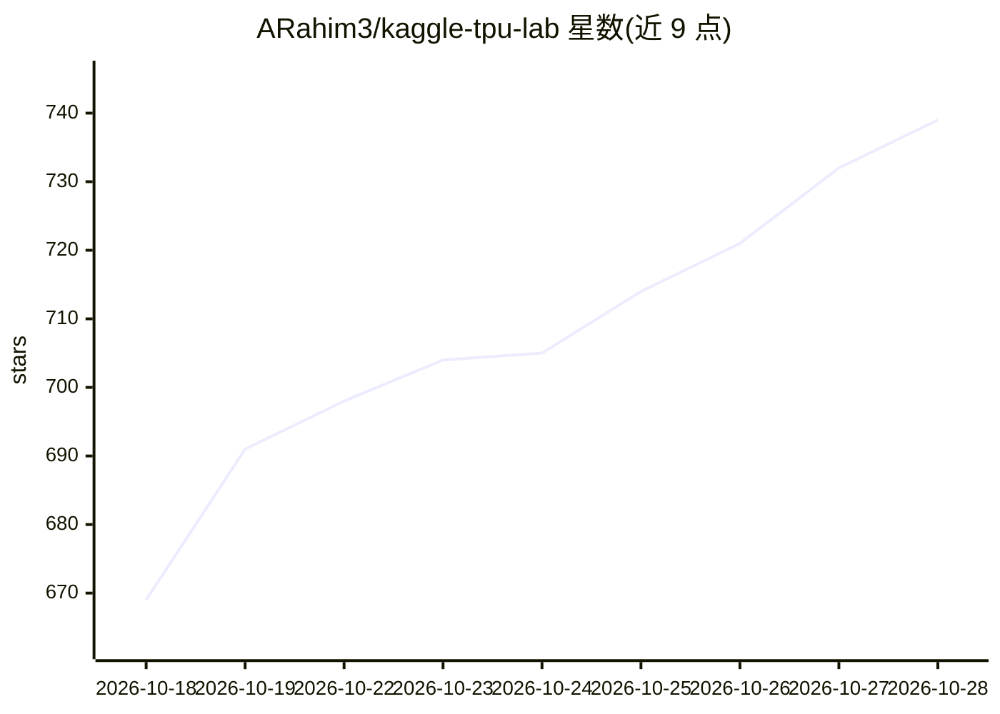

# ARahim3/kaggle-tpu-lab

⭐ 743 · Python · MIT · 推送 2026-10-06 · [GitHub](https://github.com/ARahim3/kaggle-tpu-lab) · 个人维护

**在 Kaggle 免费 TPU 上运行开源模型并暴露 API 端点的方案集**

一套在 Kaggle 免费 TPU v5e-8 上部署开源模型的实验配方：每个模型一个文件夹，含一键运行的 Kaggle notebook、内核脚本与测量说明。已含 Qwen3.8-27B（vllm-tpu 加一个补丁）与 GLM-5.3-Flash 320B MoE（自研 JAX 引擎），262k 上下文，支持前缀缓存。会话通过 Cloudflare 隧道输出兼容 OpenAI/Anthropic API 的公网 URL，可接入 Claude Code、Codex CLI、opencode 等编程代理。限制：单会话最长约九小时，需 Kaggle TPU 配额（每周约 20 TPU 小时），部分账号需身份验证。也提供 GCP TPU VM 部署脚本。

## 筛选速览

| 维度 | 判定 | 备注 |
|---|---|---|
| AI 角色 | `ai-ecosystem` | LLM/agent 周边工具 |
| 许可风险 | `permissive` | MIT |
| 部署形态 | `None` |  |
| 模型依赖 | local-ok | 支持本地模型 |
| 硬件要求 | — | 无带数字的原话,不猜 |
| 安装摩擦 | `low` | 无编译、无系统依赖或容器化 |
| 成熟度 | — | 结构信号不足 |

## 能力要点

- GLM-5.3-Flash 320B MoE 的自研 JAX TPU 引擎（3-bit 专家/int8）
- Qwen3.8-27B bf16 于 vllm-tpu 运行，262k 上下文
- 通过 Cloudflare 隧道输出兼容 OpenAI/Anthropic API 的端点
- 提供 Kaggle notebook 与终端 CLI 两种启动途径

## 适用场景

- 无自有 GPU 时免费跑开源模型做编程代理后端
- 把 Claude Code / Codex CLI 指向自建端点
- 在租用的 GCP TPU VM 上无时限运行同一套配方

## 场景标签

`推理引擎` · 领域:训练与推理

## 证据(README 行号)

> L3: Run open models on Kaggle's free TPU v5e-8 and get a public endpoint that speaks the
> L4: OpenAI and Anthropic APIs. Point Claude Code, Codex CLI, opencode or anything else at it.
> L12: |Qwen3.8-27B|bf16, no quantization|262k|~130 tok/s|~540 tok/s at 8|10,300 tok/s|~22 min|vllm-tpu + one patch|notebo

## 星数曲线

2026-10-18 669 → 2026-10-28 739（+70）

---
*卡片 v1 · prompt 1.4 · 生成 2026-10-21 · 置信度 high · 依据 README sha `a2613670d267` · [字段定义](../../DATASET.md)*
