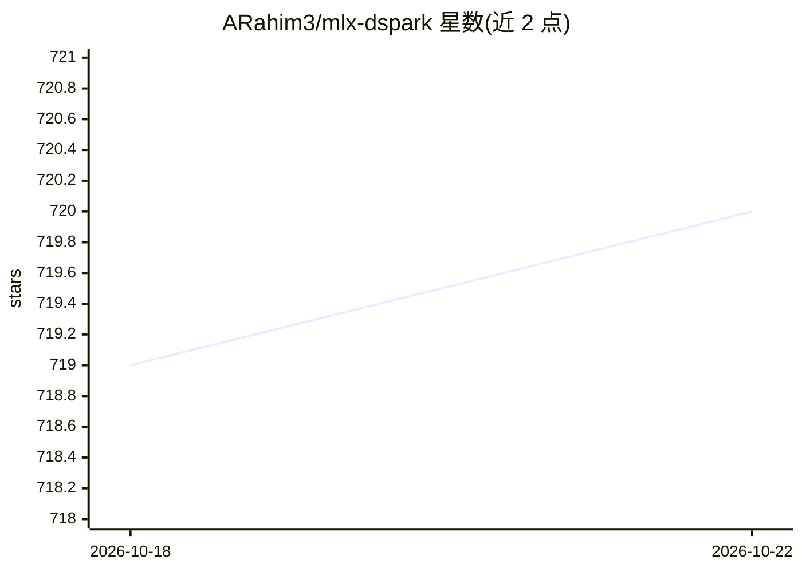

# ARahim3/mlx-dspark

⭐ 723 · Python · MIT · 推送 2026-10-05 · [GitHub](https://github.com/ARahim3/mlx-dspark) · [官网](https://arahim.dev/mlx-dspark/) · 个人维护

**Apple Silicon 上的无损投机解码推理引擎（DSpark/DFlash 的 MLX 移植）**

将 DeepSeek 的 DSpark 与 z-lab 的 DFlash 两类 EAGLE 族投机解码 drafter 以 MLX 原生移植到 Apple Silicon：目标模型逐 token 验证草稿，输出与普通解码一致（lossless）。支持 Gemma-4、Qwen3 系列、LFM2.5、Nemotron 等目标模型，提供 CLI、Python 接口、OpenAI/Anthropic 兼容 API 服务器及带校准遥测的原生 Mac 应用。首次运行时测量本机 verify/drafter 成本曲线（约 5 秒、有缓存）自行推导草稿上限；不运行 DeepSeek-V4，不提供 GGUF 互操作。

## 筛选速览

| 维度 | 判定 | 备注 |
|---|---|---|
| AI 角色 | `ai-ecosystem` | LLM/agent 周边工具 |
| 许可风险 | `permissive` | MIT |
| 部署形态 | `library` | 以包/库形式分发 |
| 模型依赖 | locked-api |  |
| 硬件要求 | — | 无带数字的原话,不猜 |
| 安装摩擦 | `medium` | 含编译或系统依赖之一 |
| 成熟度 | — | 结构信号不足 |

## 能力要点

- DSpark（半自回归）与 DFlash（block diffusion）双 drafter，同一验证循环下运行
- 目标模型逐 token 验证，输出与普通解码一致（lossless by construction）
- 单端口同时提供 OpenAI 与 Anthropic 兼容 API，支持流式/非流式与连续批处理
- 按本机测量的成本曲线自动推导草稿上限，M1/M5 各自得到独立最优值

## 适用场景

- 在 Mac 上以更高速度本地运行 Qwen3、Gemma-4 等模型且输出不变
- 给 LM Studio、Open WebUI 等本地工具提供一个 OpenAI 兼容的加速后端
- 让 Claude Code 等编码 agent 使用自己 Mac 上的模型
- 用 benchmark 命令复现加速表并做逐 token 一致性验证

## 场景标签

`推理引擎` · 领域:训练与推理

## 证据(README 行号)

> L5:  plus any matched DSpark / DFlash checkpoint. Run them at the CLI, from Python, serve an OpenAI-compatible API to LM
> L16: mlx-dspark runs two EAGLE-family speculative-decoding drafters natively on Apple Silicon: DeepSeek's
> L146: mlx-dspark serve    --model mlx-community/Qwen3-8B-8bit   # OpenAI + Anthropic API on :8080

## 星数曲线

2026-10-18 719 → 2026-10-22 720（+1）

---
*卡片 v1 · prompt 1.4 · 生成 2026-10-21 · 置信度 high · 依据 README sha `f0d1bae1e537` · [字段定义](../../DATASET.md)*
