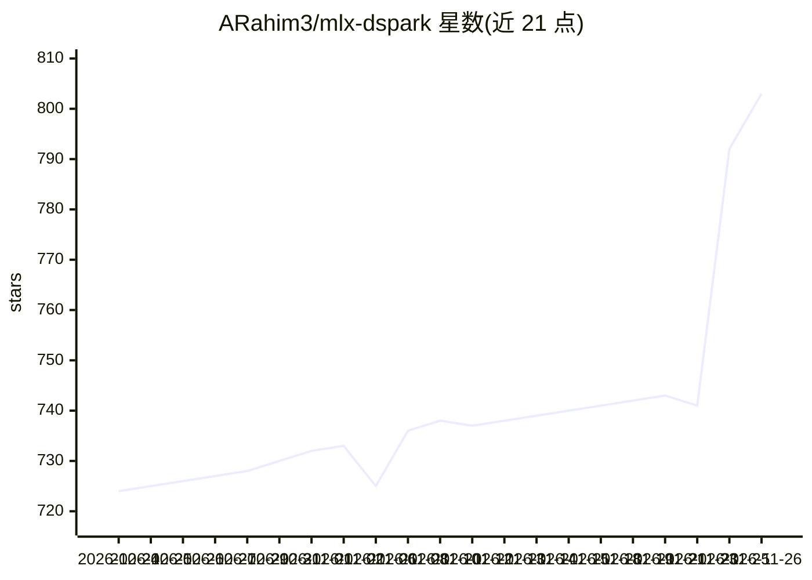

# ARahim3/mlx-dspark

⭐ 803 · Python · MIT · 推送 2026-11-24 · [GitHub](https://github.com/ARahim3/mlx-dspark) · [官网](https://arahim.dev/mlx-dspark/) · 个人维护

**Apple Silicon 上的无损投机解码推理引擎，加速本地 LLM**

在 Apple Silicon 上原生运行 EAGLE 系投机解码（DeepSeek DSpark、z-lab DFlash/DFlash 2、DSpine），目标模型逐 token 验证，输出与普通解码一致。提供 CLI、Python 接口及单端口 OpenAI/Anthropic 兼容 API 服务器，支持 tool calling、前缀缓存与并发批处理；首运行自动测量本机成本曲线推导 draft 上限。限制：仅支持 Apple Silicon + Python ≥3.10，加速对象为已发布配套 drafter 的消费级模型。

## 筛选速览

| 维度 | 判定 | 备注 |
|---|---|---|
| AI 角色 | `ai-ecosystem` | LLM/agent 周边工具 |
| 许可风险 | `permissive` | MIT |
| 部署形态 | `library` | 以包/库形式分发 |
| 模型依赖 | — | README 未给出锁定关系 |
| 硬件要求 | — | 无带数字的原话,不猜 |
| 安装摩擦 | `low` | 无编译、无系统依赖或容器化 |
| 成熟度 | — | 结构信号不足 |

## 能力要点

- 无损投机解码：目标模型逐 token 验证，输出与普通解码相同
- 提供 OpenAI/Anthropic 兼容 API 服务器，单端口三种 API 方言
- 自动从 --model 解析匹配 drafter 与该组合的实测最优设置
- 原生 Mac 应用：模型管理、投机解码遥测与 roofline 视图

## 适用场景

- 在 Mac 上加速本地 LLM 解码供代理/助手日常使用
- 用本地模型驱动 Claude Code 或 Codex
- 向 Open WebUI、SillyTavern 等现有前端提供更快推理后端
- 基准对比多种投机解码方法的速度

## 场景标签

`推理引擎` `编码 Agent` · 领域:编码与开发

## 证据(README 行号)

> L5:  plus any matched drafter checkpoint. Run it at the CLI, from Python, or as an OpenAI- and Anthropic-compatible serv
> L16: mlx-dspark runs EAGLE-family speculative-decoding drafters natively on Apple Silicon: DeepSeek's
> L121: Apple Silicon + Python ≥ 3.10; installs mlx ≥ 0.32.0 automatically (0.32's quantized-matmul kernels are

## 星数曲线

2026-10-24 724 → 2026-11-26 803（+79）

---
*卡片 v1 · prompt 1.4 · 生成 2026-11-26 · 置信度 high · 依据 README sha `43bf62bf41b3` · [字段定义](../../DATASET.md)*
