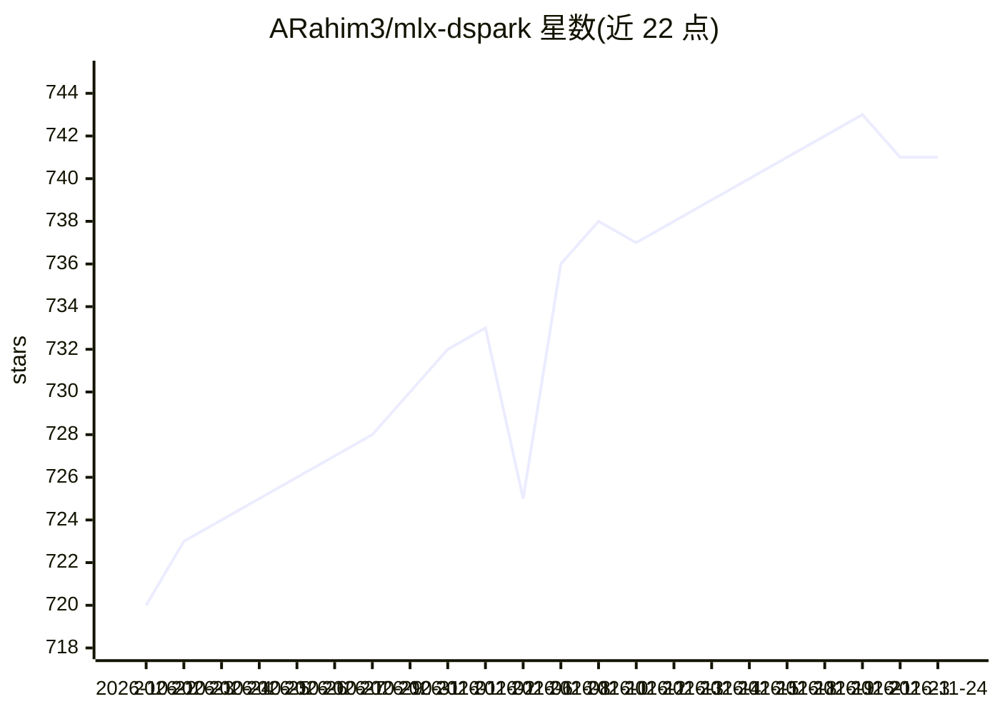

# ARahim3/mlx-dspark

⭐ 792 · Python · MIT · 推送 2026-11-23 · [GitHub](https://github.com/ARahim3/mlx-dspark) · [官网](https://arahim.dev/mlx-dspark/) · 个人维护

**Apple Silicon 上的无损推测解码推理运行时（MLX 原生）**

在 Apple Silicon 上通过 MLX 原生运行 DeepSeek 的 DSpark 与 z-lab 的 DFlash 两种 EAGLE 族推测解码方法：目标模型逐 token 验证，输出与普通解码一致。提供 CLI 生成、Python 调用、单端口同时提供 OpenAI 与 Anthropic 兼容 API 的服务模式，以及原生 Mac 桌面应用（会话聊天、模型管理、解码遥测、性能校准）。首次运行会实测本机成本曲线并自动推导 draft 上限；要求 Apple Silicon 与 Python ≥ 3.10，模型权重从 Hugging Face 缓存下载。

## 筛选速览

| 维度 | 判定 | 备注 |
|---|---|---|
| AI 角色 | `ai-ecosystem` | LLM/agent 周边工具 |
| 许可风险 | `permissive` | MIT |
| 部署形态 | `library` | 以包/库形式分发 |
| 模型依赖 | — | README 未给出锁定关系 |
| 硬件要求 | — | 无带数字的原话,不猜 |
| 安装摩擦 | `medium` | 含编译或系统依赖之一 |
| 成熟度 | — | 结构信号不足 |

## 能力要点

- 无损推测解码：目标模型验证每个草稿 token，输出与普通解码一致
- OpenAI 与 Anthropic 兼容 API 同端口服务，支持连续批处理
- 首跑约 5 秒实测本机验证/草稿成本曲线，自动推导 draft 上限
- 原生 Mac 应用：模型管理、'This Mac' roofline 视图与无损校验 Race

## 适用场景

- 在 Mac 本地加速运行 Gemma-4 / Qwen3 等消费级模型
- 为 Claude Code 或本地编码 Agent 提供更快的自托管模型
- 把本地模型以 OpenAI 兼容接口接入 Open WebUI / SillyTavern 等前端
- 用 benchmark 命令复现表格中的加速比数据

## 场景标签

`推理引擎` · 领域:训练与推理

## 证据(README 行号)

> L5:  plus any matched DSpark / DFlash checkpoint. Run them at the CLI, from Python, serve an OpenAI-compatible API to LM
> L16: mlx-dspark runs two EAGLE-family speculative-decoding drafters natively on Apple Silicon: DeepSeek's
> L148: mlx-dspark serve    --model mlx-community/Qwen3-8B-8bit   # OpenAI + Anthropic API on :8080

## 星数曲线

2026-10-22 720 → 2026-11-24 741（+21）

---
*卡片 v1 · prompt 1.4 · 生成 2026-11-24 · 置信度 high · 依据 README sha `f591b959f890` · [字段定义](../../DATASET.md)*
