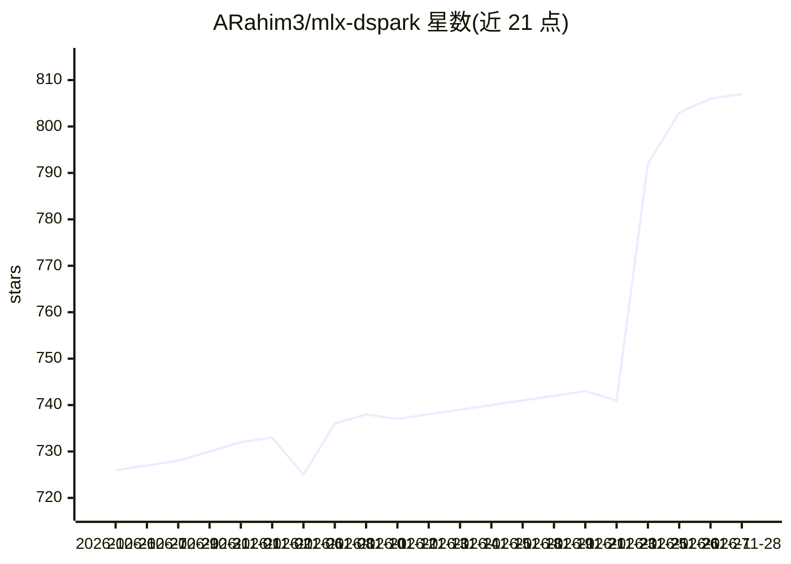

# ARahim3/mlx-dspark

⭐ 807 · Python · MIT · 推送 2026-11-26 · [GitHub](https://github.com/ARahim3/mlx-dspark) · [官网](https://arahim.dev/mlx-dspark/) · 个人维护

**给 Mac/Apple Silicon 用户提供无损加速本地 LLM 解码的推理工具**

基于 MLX 在 Apple Silicon 上原生运行的投机解码引擎，实现 DSpark、DFlash、DFlash 2、DSpine 等方法：由草稿模型生成候选 token，目标模型逐一验证，输出与普通解码一致，仅改变速度。支持 Gemma-4、Qwen3 系列、LFM2.5、Nemotron 等目标模型，草稿器按 --model 自动解析。提供 CLI、Python 库、单端口兼容 OpenAI/Anthropic 协议的 HTTP 服务及原生 Mac 应用；需 Apple Silicon 与 Python ≥ 3.10，模型权重从 Hugging Face 下载。

## 筛选速览

| 维度 | 判定 | 备注 |
|---|---|---|
| AI 角色 | `ai-ecosystem` | LLM/agent 周边工具 |
| 许可风险 | `permissive` | MIT |
| 部署形态 | `library` | 以包/库形式分发 |
| 模型依赖 | — | README 未给出锁定关系 |
| 硬件要求 | — | 无带数字的原话,不猜 |
| 安装摩擦 | `low` | 无编译、无系统依赖或容器化 |
| 成熟度 | — | 结构信号不足 |

## 能力要点

- 无损投机解码：目标模型逐 token 验证，输出与普通解码一致
- 草稿器自动解析，未收录模型可用 --mode auto 无草稿投机
- 单端口同时提供 OpenAI 与 Anthropic 协议 API，含工具调用与前缀缓存
- 原生 Mac 应用：模型适配检测、投机解码遥测、无损校验 Race 功能

## 适用场景

- 在 Mac 上本地运行开源模型并缩短生成等待时间
- 为 Claude Code/Codex 等编码 agent 提供本地模型后端
- 给 Open WebUI、SillyTavern 等前端切换到带投机的本地服务
- 用 benchmark 命令复现不同模型的解码速度数据

## 场景标签

`推理引擎` · 领域:训练与推理

## 证据(README 行号)

> L5:  plus any matched drafter checkpoint. Run it at the CLI, from Python, or as an OpenAI- and Anthropic-compatible serv
> L16: mlx-dspark runs EAGLE-family speculative-decoding drafters natively on Apple Silicon: DeepSeek's
> L121: Apple Silicon + Python ≥ 3.10; installs mlx ≥ 0.32.5 automatically (its few-row kernels make every

## 星数曲线

2026-10-26 726 → 2026-11-28 807（+81）

---
*卡片 v1 · prompt 1.4 · 生成 2026-11-27 · 置信度 high · 依据 README sha `4f385b388722` · [字段定义](../../DATASET.md)*
