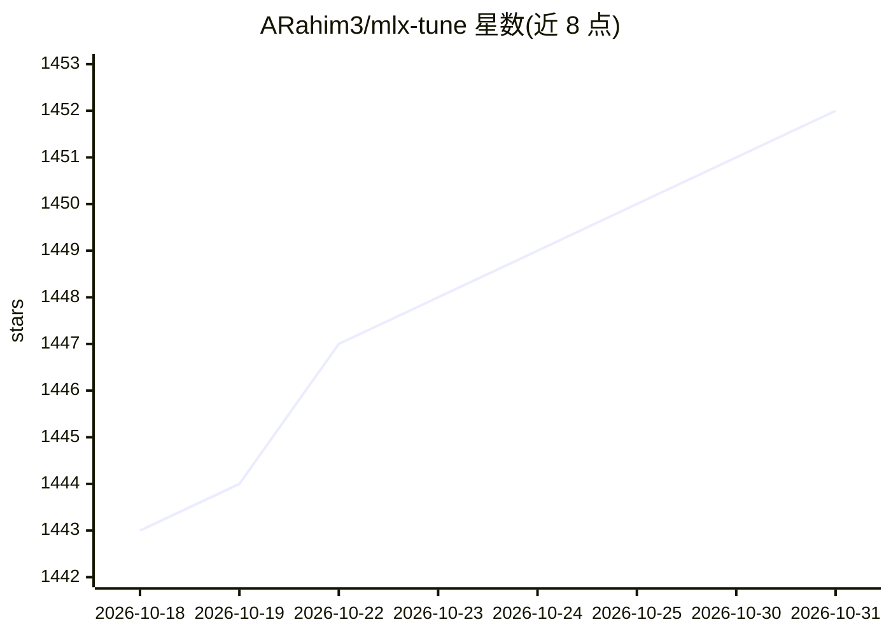

# ARahim3/mlx-tune

⭐ 1,452 · Python · Apache-2.0 · 推送 2026-06-23 · [GitHub](https://github.com/ARahim3/mlx-tune) · [官网](https://arahim3.github.io/mlx-tune/) · 个人维护

**Apple Silicon 上的模型微调框架，兼容 Unsloth API**

基于 Apple MLX 框架封装的微调库，提供与 Unsloth 兼容的 FastLanguageModel/SFTTrainer 等 API，使训练脚本可在 Mac 本地与云端 CUDA 之间复用。支持 SFT/DPO/ORPO/GRPO/KTO/SimPO 训练，覆盖 LLM、视觉语言模型（VLM）、TTS、STT、Embedding、OCR 与 JEPA 系列方法，并可导出 HuggingFace 格式或 GGUF。以 pip 包形式安装，面向需要在 Mac（M1-M5）上本地原型化微调再扩展到云端 GPU 的开发者。

## 筛选速览

| 维度 | 判定 | 备注 |
|---|---|---|
| AI 角色 | `ai-ecosystem` | LLM/agent 周边工具 |
| 许可风险 | `permissive` | Apache-2.0 |
| 部署形态 | `library` | 以包/库形式分发 |
| 模型依赖 | local-ok | 支持本地模型 |
| 硬件要求 | — | 无带数字的原话,不猜 |
| 安装摩擦 | `medium` | 含编译或系统依赖之一 |
| 成熟度 | — | 结构信号不足 |

## 能力要点

- Unsloth 兼容 API，训练脚本可在 Mac 与 CUDA 集群间复用
- 支持 SFT/DPO/ORPO/GRPO/KTO/SimPO 及持续预训练（CPT）
- 覆盖 VLM、TTS、STT、Embedding、OCR、JEPA 多类模型的微调
- 可导出 HuggingFace 格式与 GGUF（用于 Ollama/llama.cpp）

## 适用场景

- 在 MacBook 上本地微调 LLM 后再推到云端 GPU 扩展
- 微调 Whisper 等 STT 模型用于语音转录任务
- 微调 OCR 或视觉语言模型做文档理解
- 微调 Embedding 模型用于语义检索

## 场景标签

`微调` · 领域:训练与推理

## 证据(README 行号)

> L4:  SFT, DPO, GRPO, Vision, TTS, STT, Embedding, and OCR fine-tuning — natively on MLX. Unsloth-compatible API.
> L29: > Since Unsloth relies on Triton (which Macs don't have, yet), I couldn't use it locally. I built `mlx-tune` to sol
> L31: > **The goal isn't to replace Unsloth or claim superior performance.** The goal is **code portability**: allowing y

## 星数曲线

2026-10-18 1,443 → 2026-10-31 1,452（+9）

---
*卡片 v1 · prompt 1.4 · 生成 2026-10-21 · 置信度 high · 依据 README sha `d57d31862296` · [字段定义](../../DATASET.md)*
