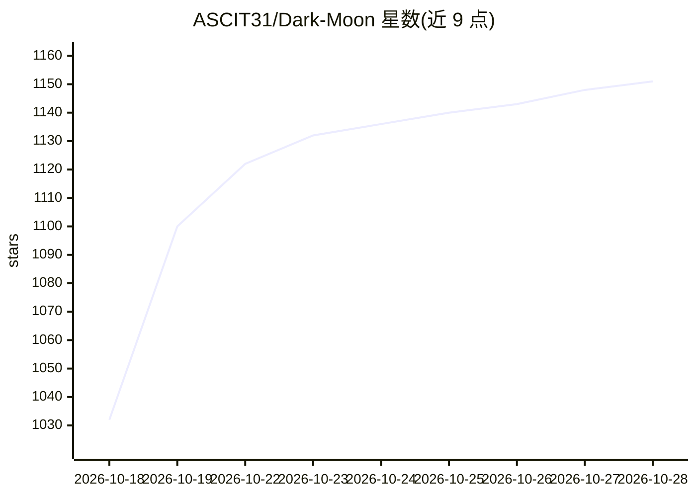

# ASCIT31/Dark-Moon

⭐ 1,151 · Python · GPL-3.0 · 推送 2026-10-27 · [GitHub](https://github.com/ASCIT31/Dark-Moon) · [官网](https://dark-moon.org/) · 组织维护

**自主 AI 渗透测试平台：50 个专家代理自动发现并验证漏洞**

开源（GPLv3）自主渗透测试工具：指向授权目标后自动执行侦察、漏洞发现与利用验证，每个发现附带确切命令与原始输出。包含 50 个专家代理，覆盖 Web、API、Active Directory、Kubernetes、云、CI/CD 及 AI/LLM 端点（OWASP LLM Top 10，garak 探针）。通过 MCP 接口编排 140+ 攻击工具；Privacy Gateway 在本地对真实 IP/凭据做可逆脱敏。支持云端模型（Anthropic/OpenAI/OpenRouter）与本地模型（Ollama/llama.cpp）。CLI 为开源版，另有付费 Pro 版（Web 面板、自动修复 PR）。面向安全团队、DevSecOps 工程师与红队人员。

## 筛选速览

| 维度 | 判定 | 备注 |
|---|---|---|
| AI 角色 | `ai-native` | 本体是模型或模型工具 |
| 许可风险 | `viral` | GPL-3.0 |
| 部署形态 | `self-host` | docker 或自建部署 |
| 模型依赖 | local-ok | 支持本地模型 |
| 硬件要求 | — | 无带数字的原话,不猜 |
| 安装摩擦 | `low` | 无编译、无系统依赖或容器化 |
| 成熟度 | — | 结构信号不足 |

## 能力要点

- 50 个专家代理串联 Web/API/AD/K8s/云/CI-CD/LLM 全攻击面
- Privacy Gateway 本地可逆脱敏，模型只见占位符
- 经 MCP 受控接口编排 140+ 攻击工具，AI 不直接执行命令
- 开源版为 CLI，Pro 版提供 Web 面板与人工审核的修复 PR

## 适用场景

- 对自有基础设施跑自动化渗透测试并获得带命令证据的漏洞报告
- 在 CI/CD 流水线中按严重级别阻断构建
- 用本地 LLM 完成全程不出网的合规渗透测试

## 场景标签

`网络安全` `多智能体` · 领域:Agent 开发

## 证据(README 行号)

> L17: **DarkMoon is autonomous AI penetration testing for your own infrastructure.** Point it at an authorized target and
> L163: DarkMoon is an **open-source AI penetration testing** platform. Point it at a target you are authorized to test, a

## 星数曲线

2026-10-18 1,032 → 2026-10-28 1,151（+119）

---
*卡片 v1 · prompt 1.4 · 生成 2026-10-21 · 置信度 mid · 依据 README sha `0c836a4c8c5f` · [字段定义](../../DATASET.md)*
