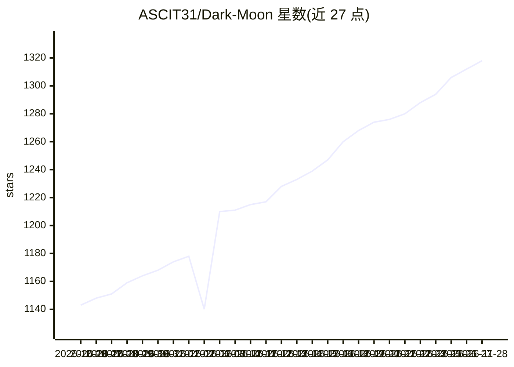

# ASCIT31/Dark-Moon

⭐ 1,318 · Python · AGPL-3.0 · 推送 2026-11-22 · [GitHub](https://github.com/ASCIT31/Dark-Moon) · [官网](https://dark-moon.org/) · 组织维护

**安全团队的自主 AI 渗透测试工具，本地 LLM 运行**

开源的自主 AI 渗透测试 CLI 工具：指向授权目标后自动执行整个评估流程，每个漏洞附带确切命令与原始输出。覆盖 Web、API、云（AWS/Azure/GCP）、Active Directory、Kubernetes、CI/CD、数据库与 AI/LLM 端点（OWASP LLM Top 10，garak 探针），50 个专项 agent 经 MCP 接口编排 140+ 攻防工具。Privacy Gateway 在本地对 IP、主机、凭据做可逆令牌化，模型仅见占位符；攻击路径按服务器记录标注 Possible/Evidence-Backed。依赖 Docker 与 LLM API key 或本地模型。Pro 为付费版，提供 Web 仪表盘与修复 PR 重测。

## 筛选速览

| 维度 | 判定 | 备注 |
|---|---|---|
| AI 角色 | `ai-native` | 本体是模型或模型工具 |
| 许可风险 | `viral` | AGPL-3.0 |
| 部署形态 | `self-host` | docker 或自建部署 |
| 模型依赖 | local-ok | 支持本地模型 |
| 硬件要求 | — | 无带数字的原话,不猜 |
| 安装摩擦 | `low` | 无编译、无系统依赖或容器化 |
| 成熟度 | — | 结构信号不足 |

## 能力要点

- 50 个专项 agent，覆盖 Web/API/云/AD/K8s/CI-CD/AI-LLM 端点
- 本地 LLM + Privacy Gateway 本地令牌化，真实值不出边界
- 每个发现附带确切命令与原始输出，攻击路径分 Possible/Evidence-Backed
- 经 MCP 编排 140+ 攻防工具，含 OWASP LLM Top 10 garak 探针

## 适用场景

- 对自己的基础设施执行授权的自主渗透测试
- 要求真实 IP/凭据不出边界的本地化渗透评估
- 在 CI/CD 流水线中触发渗透测试并将发现作为产物返回
- 探测 AI/LLM 推理端点的安全弱点

## 场景标签

`网络安全` · 领域:学习与行业

## 证据(README 行号)

> L20: **DarkMoon is autonomous AI penetration testing for your own infrastructure.** Point it at an authorized target and
> L24: - 🔒 **Runs on a local LLM + Privacy Gateway.** The gateway tokenizes your real IPs, hosts and credentials locally, 
> L98: |🤖 **Pentests your AI too**|A dedicated LLM agent probes AI/LLM inference endpoints for the OWASP LLM Top 10 with g

## 星数曲线

2026-10-26 1,143 → 2026-11-28 1,318（+175）

---
*卡片 v1 · prompt 1.4 · 生成 2026-11-23 · 置信度 high · 依据 README sha `efcc8555e16f` · [字段定义](../../DATASET.md)*
