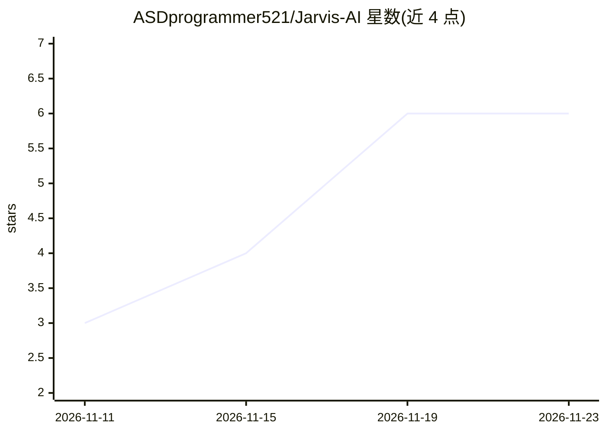

# ASDprogrammer521/Jarvis-AI

⭐ 6 · Python · MIT · 推送 2026-11-21 · [GitHub](https://github.com/ASDprogrammer521/Jarvis-AI) · [官网](https://jarvis-by-asdcuber.netlify.app) · 个人维护

**面向个人用户的 PC+手机语音 AI 助手，自动化桌面操作**

基于 Python 的个人 AI 助手，通过 Gemini API 驱动语音/文本指令，覆盖应用与窗口控制、文件操作、屏幕内容读取、Gmail 与日历操作、收据扫描记账等。配套原生 Android 手机应用，经加密链路实现来电、短信、查找手机与文件传输。内置 Hand Space：仅用摄像头在本地实现手势抓取玻璃卡片式文件浏览。提供 Windows EXE 与 Android APK 下载，也可从源码运行（需 Python 3.11+）。MIT 许可。

## 筛选速览

| 维度 | 判定 | 备注 |
|---|---|---|
| AI 角色 | `ai-native` | 本体是模型或模型工具 |
| 许可风险 | `permissive` | MIT |
| 部署形态 | `desktop` | 安装包/桌面程序 |
| 模型依赖 | — | README 未给出锁定关系 |
| 硬件要求 | — | 无带数字的原话,不猜 |
| 安装摩擦 | `low` | 无编译、无系统依赖或容器化 |
| 成熟度 | — | 结构信号不足 |

## 能力要点

- 语音/文本控制应用、窗口、文件、浏览器与系统设置
- Android 手机伴侣应用：通话、短信、查找手机、大文件传输
- Hand Space 手势文件浏览（仅摄像头、本地运行）
- 插件目录 actions/ 自动发现，支持从 URL 安装

## 适用场景

- 用语音完成开关应用、整理窗口等日常电脑操作
- 手机上远程控制电脑或反之操作手机
- 拍照扫描收据自动记录支出分类
- 通过手势浏览磁盘、文件夹、图片与笔记

## 场景标签

`AI 助手` `GUI 自动化` · 领域:效率与自动化

## 证据(README 行号)

> L17: **Jarvis AI** is an intelligent assistant that automates your workflow and simplifies everyday computer tasks. A cl
> L31: 4. Enter your **Gemini API key** on first launch.

## 星数曲线

2026-11-11 3 → 2026-11-23 6（+3）

---
*卡片 v1 · prompt 1.4 · 生成 2026-11-20 · 置信度 mid · 依据 README sha `155d8269ec55` · [字段定义](../../DATASET.md)*
