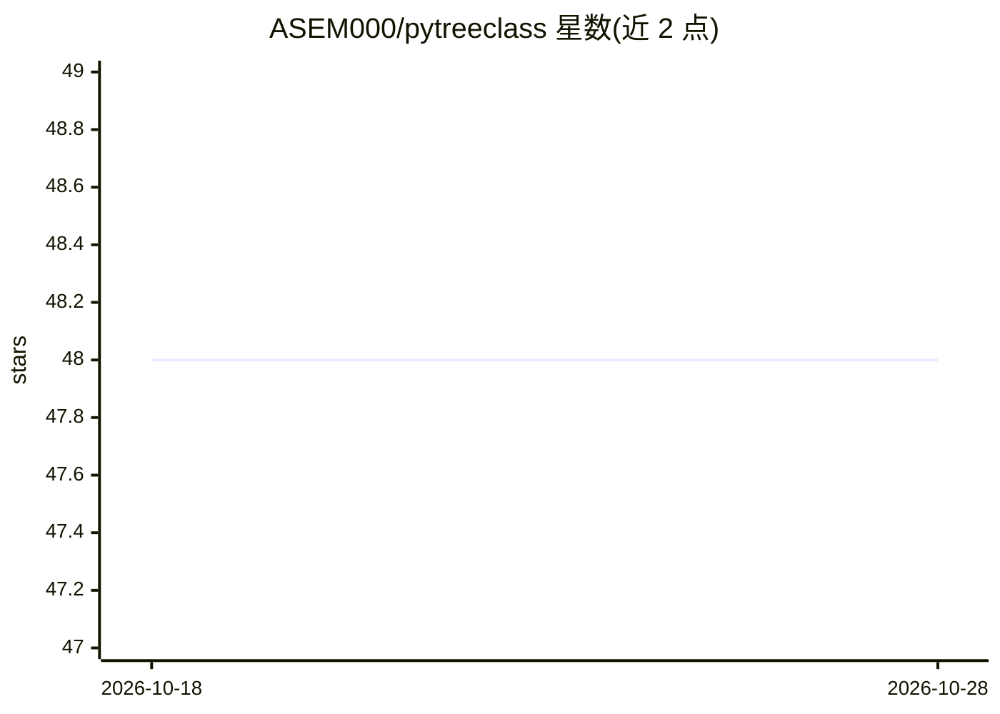

# ASEM000/pytreeclass

⭐ 48 · Python · Apache-2.0 · 推送 2026-08-18 · [GitHub](https://github.com/ASEM000/pytreeclass) · [官网](https://pytreeclass.rtfd.io/en/latest) · 个人维护

**JAX 开发者的有状态 PyTree 类构建库**

面向使用 JAX 的开发者：提供 TreeClass 类构建器，以 dataclass 风格创建和操作有状态的 JAX PyTree，借鉴 numpy 与 dataclasses 的使用习惯；在 jax.jit 下通过 .at[方法名] 的函数式调用更新实例状态，无需将变量从类中分离。支持 flatten/unflatten 与简单训练的性能基准（与 Flax、Equinox 对比），提供 pip 安装与开发版源码安装，文档含常见示例与 Colab 笔记。

## 筛选速览

| 维度 | 判定 | 备注 |
|---|---|---|
| AI 角色 | `ai-ecosystem` | LLM/agent 周边工具 |
| 许可风险 | `permissive` | Apache-2.0 |
| 部署形态 | `library` | 以包/库形式分发 |
| 模型依赖 | — | README 未给出锁定关系 |
| 硬件要求 | — | 无带数字的原话,不猜 |
| 安装摩擦 | `low` | 无编译、无系统依赖或容器化 |
| 成熟度 | — | 结构信号不足 |

## 能力要点

- 以 dataclass 风格创建有状态 JAX PyTree
- jax.jit 下通过 .at[方法].__call__() 函数式更新状态
- 与 Flax、Equinox 的 flatten/unflatten 与训练性能基准

## 适用场景

- 在 JAX 中定义带状态的可 jit 模型/计数器等结构
- 替代手写 PyTree 展开与状态分离样板代码
- 比较不同 PyTree 库的性能表现

## 场景标签

 · 领域:机器学习基础设施/数据结构库

## 证据(README 行号)

> L37: `pytreeclass` is a JAX-compatible class builder to create and operate on stateful JAX PyTrees in a performant and i
> L52: Under jax.jit jax requires states to be explicit, this means that for any class instance; variables needs to be sep

## 星数曲线

2026-10-18 48 → 2026-10-28 48（+0）

---
*卡片 v1 · prompt 1.4 · 生成 2026-10-25 · 置信度 high · 依据 README sha `cdd7a19aa2ed` · [字段定义](../../DATASET.md)*
