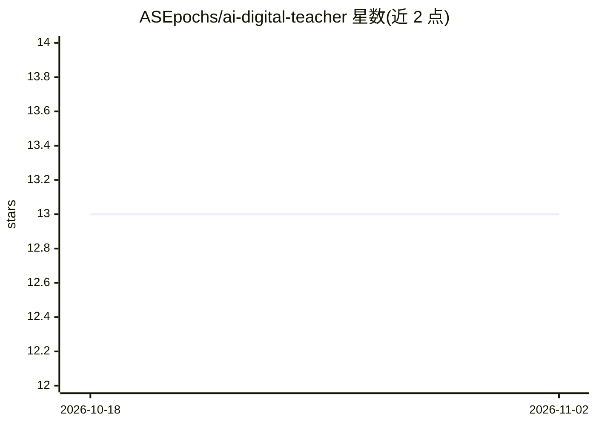

# ASEpochs/ai-digital-teacher

⭐ 13 · Python · 推送 2026-11-01 · [GitHub](https://github.com/ASEpochs/ai-digital-teacher) · [官网](https://asepochs.github.io/ai-digital-teacher/) · 个人维护 · 中文 README

**多模态课堂观察 Agent：摄像头识别学生行为并提醒、生成报告**

面向学校管理人员、教学督导和教师的课堂观察工作台：浏览器摄像头约每 3 秒采样画面，调用豆包 Seed 多模态模型经 Ark Responses API 识别学生位置、行为与严重程度，跨帧维护座位记忆与事件合并；异常行为（进食、使用手机、趴桌等）触发 TTS 语音提醒，正常状态静默记录，课后生成逐人结构化报告。密钥仅保留在 FastAPI 后端。自述为工程原型，不做人脸识别，不支持多设备同步与长期存储。

## 筛选速览

| 维度 | 判定 | 备注 |
|---|---|---|
| AI 角色 | `ai-native` | 本体是模型或模型工具 |
| 许可风险 | `none` | — |
| 部署形态 | `library` | 以包/库形式分发 |
| 模型依赖 | — | README 未给出锁定关系 |
| 硬件要求 | — | 无带数字的原话,不猜 |
| 安装摩擦 | `low` | 无编译、无系统依赖或容器化 |
| 成熟度 | `idea` | |

## 能力要点

- 豆包 Seed 多模态模型分析摄像头帧，输出结构化课堂事件
- 基于座位位置的跨帧身份连续性、事件合并与防重复提醒
- 豆包 TTS 语音提醒，不可用时回退浏览器语音合成
- 课堂报告生成本地保留（最近 30 份）并支持 JSON 导出

## 适用场景

- 课堂上持续观察学生行为并在异常时收到语音提醒
- 课后查看学生维度的行为摘要与事件时间轴
- 在手机或电脑上以浏览器摄像头进行课堂监督

## 场景标签

`多模态` `目标检测` · 领域:感知与多模态

## 证据(README 行号)

> L34: AI Digital Teacher Agent 是一个面向智慧课堂场景的多模态观察与辅助分析系统。它通过摄像头周期性获取课堂画面，调用豆包视觉模型理解学生状态，并维护一段课堂会话中的学生位置、行为变化和提醒记录。
> L72: |推理 Reasoning|豆包 Seed 多模态模型识别学生位置、行为、严重程度和建议话术|

## 星数曲线

2026-10-18 13 → 2026-11-02 13（+0）

---
*卡片 v1 · prompt 1.4 · 生成 2026-10-31 · 置信度 high · 依据 README sha `268f70e0bca0` · [字段定义](../../DATASET.md)*
