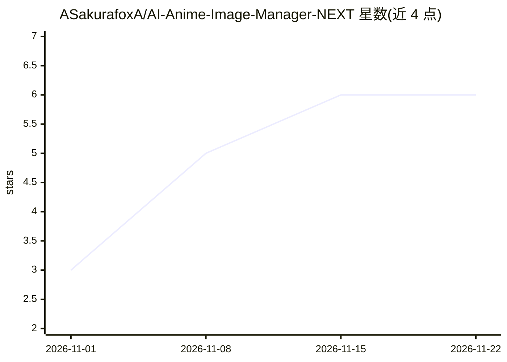

# ASakurafoxA/AI-Anime-Image-Manager-NEXT

⭐ 6 · TypeScript · MIT · 推送 2026-11-17 · [GitHub](https://github.com/ASakurafoxA/AI-Anime-Image-Manager-NEXT) · 个人维护 · 中文 README

**本地动漫图库管理器：AI 打标、角色识别与语义搜图**

基于 Uyoung666/ai-image-manager v2.2.3（MIT）修改的本地动漫图库管理器，以补丁形式分发上游增量。继承图像索引、重复图识别、以图搜图、语义搜索等能力，本版将打标模型换为 PixAI Tagger v1.0（词表 30,877、六大类），角色识别用 CCIP 外置模型，语义搜索用中文 CLIP；新增应用内回收站、标签黑名单/重命名/着色、断点续跑批量打标等。Windows 提供 MSI 安装包，模型权重经 Release 与百度网盘分发，另支持局域网手机只读浏览。

## 筛选速览

| 维度 | 判定 | 备注 |
|---|---|---|
| AI 角色 | `ai-native` | 本体是模型或模型工具 |
| 许可风险 | `permissive` | MIT |
| 部署形态 | `desktop` | 安装包/桌面程序 |
| 模型依赖 | — | README 未给出锁定关系 |
| 硬件要求 | — | 无带数字的原话,不猜 |
| 安装摩擦 | `low` | 无编译、无系统依赖或容器化 |
| 成熟度 | — | 结构信号不足 |

## 能力要点

- PixAI Tagger v1.0 自动打标：30,877 标签、六大类，含内容分级/作品系列/画风
- CCIP 角色识别，标签落库为中文并保留英文标识，中英文均可检索
- pHash+CLIP 两段式以图搜图与中文 CLIP 自然语言语义搜索
- 局域网/手机浏览器只读访问，端口与永久/临时双口令控制

## 适用场景

- 整理本地大量动漫插画并自动打标签、识别角色
- 用自然语言或一张图在图库里找相似画面
- 在手机/平板上通过局域网浏览和检索电脑里的图库

## 场景标签

`语义搜索` `目标检测` `图像视频处理` · 领域:知识与检索

## 证据(README 行号)

> L33: ### 基础功能：动漫化标签体系（**PixAI Tagger v1.0**）
> L46: |**PixAI 自动打标**|**30,877** 个标签、**六大类**（通用 / 角色 / 作品系列 / 画风 / 元信息 / 分级）；平均 **46.5~58.5 个标签/张**，**0.59 秒/张**（GPU，本机实测
> L47: |**角色识别**|直接认出是哪个角色，标签落库是中文（如 `初音未来 (hatsune_miku)`、`甘雨 (ganyu_(genshin_impact))`）|

## 星数曲线

2026-11-01 3 → 2026-11-22 6（+3）

---
*卡片 v1 · prompt 1.4 · 生成 2026-11-20 · 置信度 high · 依据 README sha `5ec830f82606` · [字段定义](../../DATASET.md)*
