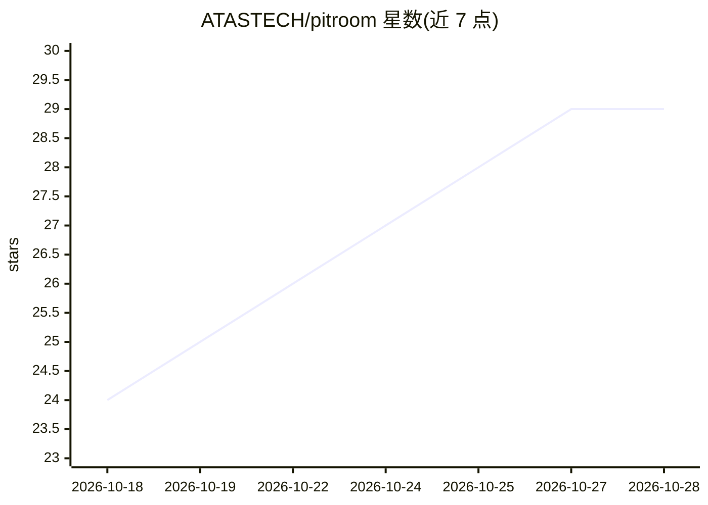

# ATASTECH/pitroom

⭐ 29 · TypeScript · MIT · 推送 2026-10-28 · [GitHub](https://github.com/ATASTECH/pitroom) · [官网](https://www.npmjs.com/package/pitroom) · 组织维护

**给编码 agent 配的并行低成本工作小组：省 token、带审计**

面向使用 Claude Code、Codex 等编码 agent 的开发者：让主 agent 决策，把读代码、修复、测试、评审交给多个可并行的廉价 worker CLI（OpenCode/Codex/Claude Code/Gemini CLI/Qwen Code/Kilo Code/Antigravity，可混合与跨级回退），只回传答案、diff 与凭证。不硬编码模型，可用免费档、本地 MLX/Ollama 或付费模型。逐条校验 worker 引用的 path:line，内置 git guard 与隔离模式防止提交/推送/批量删除，并提供 CLI、14 个 Agent Skills、Claude Code/Codex 插件与本地仪表盘。TypeScript CLI 约 6,500 行、零运行时依赖。

## 筛选速览

| 维度 | 判定 | 备注 |
|---|---|---|
| AI 角色 | `ai-ecosystem` | LLM/agent 周边工具 |
| 许可风险 | `permissive` | MIT |
| 部署形态 | `desktop` | 安装包/桌面程序 |
| 模型依赖 | local-ok | 支持本地模型 |
| 硬件要求 | — | 无带数字的原话,不猜 |
| 安装摩擦 | `low` | 无编译、无系统依赖或容器化 |
| 成熟度 | — | 结构信号不足 |

## 能力要点

- 多 worker CLI 并行执行（默认至多 20 个，可混合与跨 CLI 回退链）
- 校验 worker 引用的 path:line，输出 token 凭证与节省统计
- git guard、隔离模式与权限下限（无提交/推送/sudo/密钥读取）
- 提供 CLI、14 个 Agent Skills、Claude Code/Codex 插件与本地仪表盘

## 适用场景

- 让编码 agent 把读码、评审等开销任务委派给廉价模型并行处理
- 压缩主 agent 上下文与 premium token 消耗
- 在脏工作树上获得仅属于该 worker 的精确 diff 与可撤销补丁

## 场景标签

`编码 Agent` `多智能体` · 领域:Agent 开发

## 证据(README 行号)

> L40: > **Your agent stays in the driver's seat. A pit crew of cheap workers does the legwork in parallel, while your age
> L46: Pitroom uses your worker CLI's default model: a free tier, a local MLX/Ollama model or a cheap paid one. Switch the
> L50: OpenCode, Codex CLI, Claude Code, Gemini CLI, Qwen Code, Kilo Code and Antigravity CLI (beta on Linux and Windows).

## 星数曲线

2026-10-18 24 → 2026-10-28 29（+5）

---
*卡片 v1 · prompt 1.4 · 生成 2026-10-26 · 置信度 high · 依据 README sha `edde43d4a888` · [字段定义](../../DATASET.md)*
