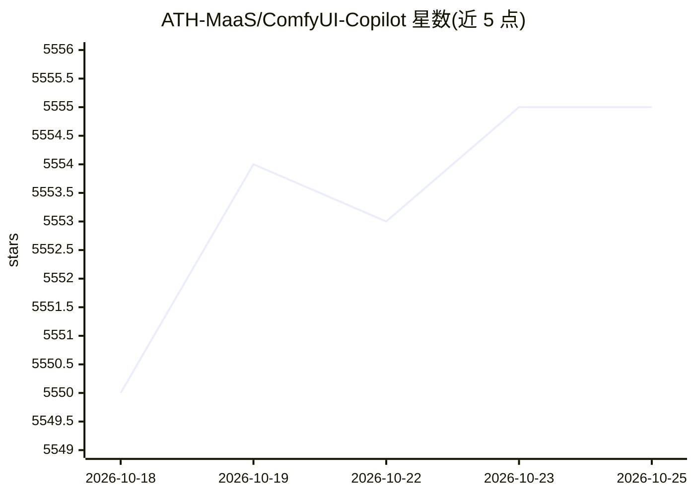

# ATH-MaaS/ComfyUI-Copilot

⭐ 5,558 · TypeScript · MIT · 推送 2026-09-11 · [GitHub](https://github.com/ATH-MaaS/ComfyUI-Copilot) · 组织维护 · 中文 README

**ComfyUI 的 AI 助手插件：生成、调试、优化工作流**

以 ComfyUI 自定义节点形式安装的 AIGC 智能助手，覆盖工作流开发全周期：按文字描述生成工作流、自动分析并修复错误、改写现有工作流（加节点/调参/改结构）、批量参数组合试验与可视化对比，另提供节点推荐、节点查询、模型与下游子图推荐。v2.0 Agent 架构感知本地 ComfyUI 环境。需自行配置模型 API Key 与 Base URL（支持 OpenAI/LMStudio 配置入口）；官方 API 服务已停用，部分功能（工作流生成等）不再可用。通过 git clone 或 ComfyUI Manager 安装。

## 筛选速览

| 维度 | 判定 | 备注 |
|---|---|---|
| AI 角色 | `ai-ecosystem` | LLM/agent 周边工具 |
| 许可风险 | `permissive` | MIT |
| 部署形态 | `desktop` | 安装包/桌面程序 |
| 模型依赖 | — | README 未给出锁定关系 |
| 硬件要求 | — | 无带数字的原话,不猜 |
| 安装摩擦 | `low` | 无编译、无系统依赖或容器化 |
| 成熟度 | — | 结构信号不足 |

## 能力要点

- 按文字描述生成工作流并一键导入画布
- 工作流自动调试与修复建议
- 参数批量组合试验与可视化对比（GenLab）
- 节点/模型/下游子图推荐，Agent 感知本地 ComfyUI 环境

## 适用场景

- 让 AI 按我的描述生成出图工作流
- 工作流报错时自动定位问题并给修复建议
- 批量尝试不同参数组合并对比出图效果

## 场景标签

`AI 助手` `图像生成` · 领域:对话与助手

## 证据(README 行号)

> L40: **ComfyUI-Copilot** is an AIGC intelligent assistant built on ComfyUI that provides comprehensive support for tedio
> L44: The newly released **ComfyUI-Copilot v2.0** evolves from a "helper tool" into a "development partner"—not just assi
> L59: - 1. 💎 **Generate First Version Workflow**: Based on your text description, we provide workflows that meet your nee

## 星数曲线

2026-10-18 5,550 → 2026-10-25 5,555（+5）

---
*卡片 v1 · prompt 1.4 · 生成 2026-10-20 · 置信度 mid · 依据 README sha `3ce62ee044b7` · [字段定义](../../DATASET.md)*
