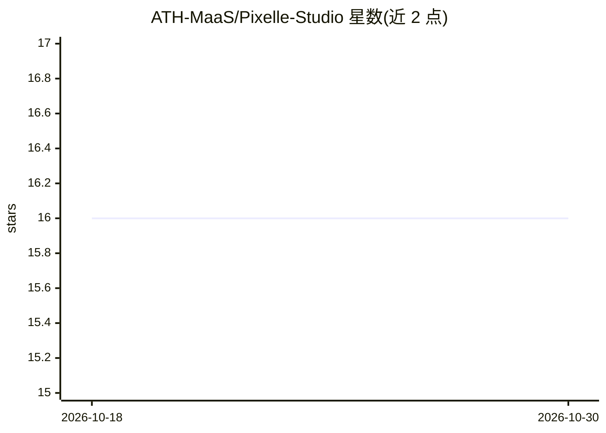

# ATH-MaaS/Pixelle-Studio

⭐ 16 · Python · Apache-2.0 · 推送 2026-02-27 · [GitHub](https://github.com/ATH-MaaS/Pixelle-Studio) · [官网](https://studio.pixelle.ai/) · 组织维护 · 中文 README

**零代码 AI 文件处理 Agent 工作台：自然语言定义工作流**

开源的 AI Agent 工作区（Python/FastAPI 后端 + Next.js 前端），面向需要生成 PDF/PPT/Excel/Word/HTML 等文件的普通用户：用自然语言把日常任务 SOP 定义为 Agent 技能，无需编程。机制上提供三级渐进式技能加载以降低 token 消耗、基于 pexpect 的持久 PTY 终端（变量跨调用保持）、三层模型故障转移与 WebSocket 心跳、MCP 协议接入外部工具（Exa/Bing 搜索、高德地图等），内置 9 个 Agent 工具。LLM 通过 OpenAI 兼容 API 配置，需用户提供 API Key。

## 筛选速览

| 维度 | 判定 | 备注 |
|---|---|---|
| AI 角色 | `ai-native` | 本体是模型或模型工具 |
| 许可风险 | `permissive` | Apache-2.0 |
| 部署形态 | `self-host` | docker 或自建部署 |
| 模型依赖 | — | README 未给出锁定关系 |
| 硬件要求 | — | 无带数字的原话,不猜 |
| 安装摩擦 | `low` | 无编译、无系统依赖或容器化 |
| 成熟度 | — | 结构信号不足 |

## 能力要点

- 自然语言零代码定义 SOP 技能，生成 PDF/PPT/Excel/HTML 等多格式文件
- 三级渐进式技能加载：12 个内置技能元数据仅约 600 tokens
- 持久 PTY 终端支持变量跨调用保持与危险命令过滤
- 三层故障转移（Key/模型/通道）+ WebSocket 心跳，MCP 接入外部工具

## 适用场景

- 用对话让 AI 生成带原生公式的 Excel 财务分析报告
- 深度调研后自动生成结构化 PPT
- 把日常文件处理流程教给 Agent，形成可复用技能

## 场景标签

`工作流自动化` `AI 助手` · 领域:效率与自动化

## 证据(README 行号)

> L18: **Pixelle Studio** is an open-source AI Agent workspace built for **expert-level file processing**. Simply **descri
> L26:  📄 Expert File Processing

## 星数曲线

2026-10-18 16 → 2026-10-30 16（+0）

---
*卡片 v1 · prompt 1.4 · 生成 2026-10-30 · 置信度 high · 依据 README sha `c54f2a2d0b43` · [字段定义](../../DATASET.md)*
