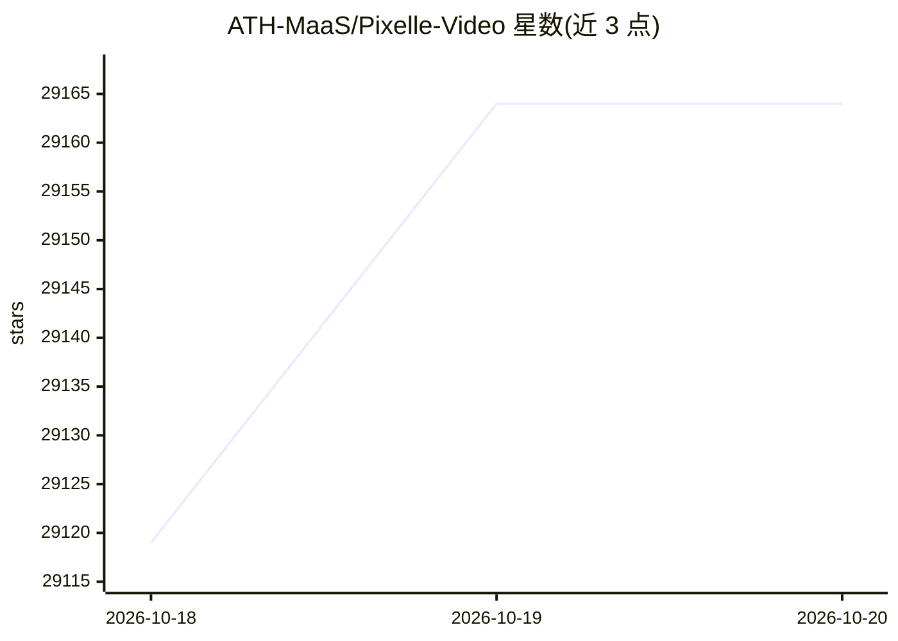

# ATH-MaaS/Pixelle-Video

⭐ 29,164 · Python · Apache-2.0 · 推送 2026-06-14 · [GitHub](https://github.com/ATH-MaaS/Pixelle-Video) · [官网](https://aidc-ai.github.io/Pixelle-Video/zh) · 组织维护 · 中文 README

**输入主题即自动生成配图、配音、字幕短视频的引擎**

以 Web UI（Streamlit）运行的短视频自动生成流水线：LLM 撰写文案，按句分镜后通过 ComfyUI/RunningHub 工作流或直连 API 生成图像/视频片段，TTS 合成解说（支持参考音频克隆音色），叠加 BGM 与 HTML 模板后合成成片。扩展模块含数字人口播、图生视频、动作迁移。Windows 提供整合包，macOS/Linux 需自装 uv 与 ffmpeg 从源码运行；LLM 与媒体模型均需配置 API Key 或本地服务。

## 筛选速览

| 维度 | 判定 | 备注 |
|---|---|---|
| AI 角色 | `ai-enhanced` | 去掉 AI 部分产品仍成立 |
| 许可风险 | `permissive` | Apache-2.0 |
| 部署形态 | `None` |  |
| 模型依赖 | local-ok | 支持本地模型 |
| 硬件要求 | — | 无带数字的原话,不猜 |
| 安装摩擦 | `medium` | 含编译或系统依赖之一 |
| 成熟度 | — | 结构信号不足 |

## 动量与使用信号

- 维护:`maintenance` — 距上次 push 125.8 天,年发版 12,15 位贡献者
- 涨星:近 1 天 **+24**(自 20261016 起算)
- 下载:GitHub Release 附件 累计 83,613(12 个 release)
- 平台:WINDOWS / WEB · 协议:MCP / OLLAMA

## 能力要点

- 输入主题即可完成文案→配图→语音→合成视频的全流程
- 支持 ComfyUI/RunningHub 工作流与 DashScope、OpenAI、Seedance、Kling 等直连 API 两种媒体生成路径
- TTS 支持 Edge-TTS、Index-TTS 及参考音频声音克隆
- 数字人口播、图生视频、动作迁移等扩展模块

## 适用场景

- 输入一个主题批量产出竖屏/横屏短视频
- 用自有文案与素材直接生成配图解说视频
- 本地 Ollama 加 ComfyUI 组成零 API 费用的生成方案

## 场景标签

`视频生成` `图像生成` `语音合成` · 领域:内容生成

## 证据(README 行号)

> L15: 只需输入一个 **主题**，Pixelle-Video 就能自动完成：
> L55: - ✅ **原子能力灵活组合** - 支持 ComfyUI / RunningHub 工作流，也支持直连 API 模型，可按需替换图像、视频、TTS、VLM 等能力
> L151: ### 从源码安装（适合 macOS / Linux 用户或需要自定义的用户）

## 星数曲线

2026-10-18 29,119 → 2026-10-20 29,164（+45）

---
*卡片 v1 · prompt 1.4 · 生成 2026-10-18 · 置信度 high · 依据 README sha `4b08a88a3d8e` · [字段定义](../../DATASET.md)*
