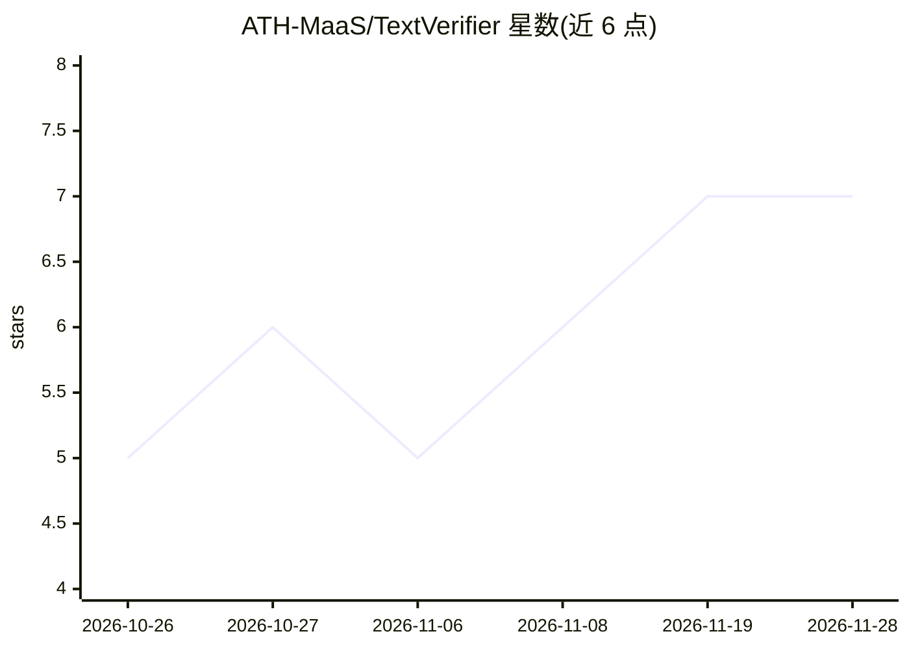

# ATH-MaaS/TextVerifier

⭐ 7 · Python · Apache-2.0 · 推送 2026-10-22 · [GitHub](https://github.com/ATH-MaaS/TextVerifier) · [官网](https://arxiv.org/abs/2610.19551) · 组织维护 · 中文 README

**面向开发者/研究者的中文汉字字形渲染错误检测验证器**

TextVerifier 是针对汉字字形结构渲染错误的验证模型：输入字形裁剪图与目标字符，检测缺笔、多笔、断笔、粘连、分裂、变形或错位等结构偏差，对字体、风格、颜色和背景变化保持不敏感。模型用 ViT-L/16 图像编码器与基于 IDS 的 DeBERTa-v2 文本编码器组成双塔结构，每个支持字符配备十个正确渲染视觉原型，按最近原型距离打分；分数还可作为 Flow-GRPO 后训练的逐字符奖励。权重与基准数据存于 Hugging Face，代码仓库仅含推理、评测与转换脚本。

## 筛选速览

| 维度 | 判定 | 备注 |
|---|---|---|
| AI 角色 | `ai-native` | 本体是模型或模型工具 |
| 许可风险 | `permissive` | Apache-2.0 |
| 部署形态 | `None` |  |
| 模型依赖 | — | README 未给出锁定关系 |
| 硬件要求 | — | 无带数字的原话,不猜 |
| 安装摩擦 | `medium` | 含编译或系统依赖之一 |
| 成熟度 | — | 结构信号不足 |

## 能力要点

- IDS 结构感知双塔编码器与每字符十个视觉原型的打分机制
- 阈值随原型资产发布并在每次预测中回显，判定可审计
- 配套 TextRenderBench-ZH 基准：299 张图、7,127 条字符级标注、608 条人工确认错误
- 支持单图与 JSONL 批量推理，输出 error_score、阈值与错误判定

## 适用场景

- 检测 AI 图像/文本生成中的汉字笔画渲染错误
- 为文字渲染模型的强化学习后训练提供逐字符奖励信号
- 在 OCR 之外对中文文字渲染质量做结构级校验

## 场景标签

`模型评测` `图像生成` `强化学习` · 领域:评测与运维

## 证据(README 行号)

> L10: TextVerifier is a target-conditioned verifier for structural Chinese glyph rendering errors. Given a glyph crop and
> L22: TextVerifier maps a glyph crop and its target character into a shared embedding space. The text tower reads the cha

## 星数曲线

2026-10-26 5 → 2026-11-28 7（+2）

---
*卡片 v1 · prompt 1.4 · 生成 2026-11-21 · 置信度 high · 依据 README sha `e61e70dbd653` · [字段定义](../../DATASET.md)*
