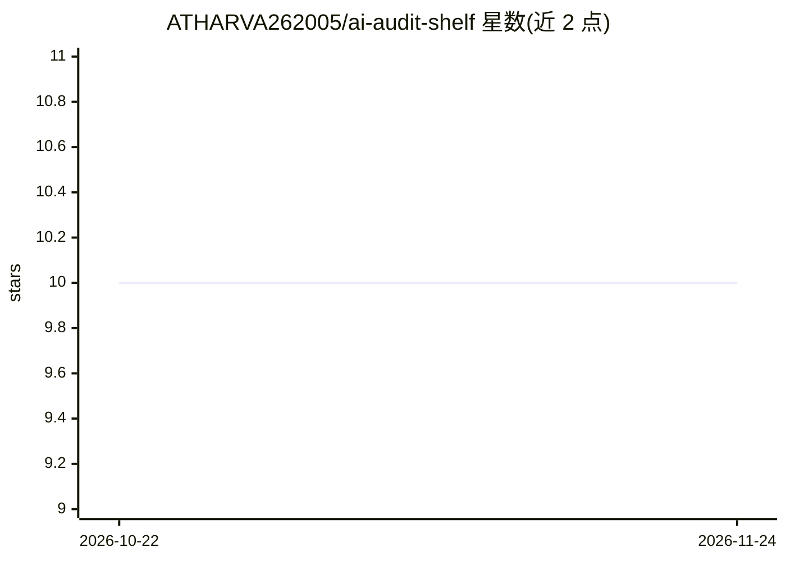

# ATHARVA262005/ai-audit-shelf

⭐ 10 · Python · NOASSERTION · 推送 2026-11-05 · [GitHub](https://github.com/ATHARVA262005/ai-audit-shelf) · 个人维护

**为 AI 工作流提供版本化审计追踪的记录工具**

将每条 AI 操作记录为不可变"章节"，章节可打包为按功能分组的"书籍"，编辑时生成新版本并保留旧版本作为审计线索。提供 CLI、FastAPI REST API、React 仪表盘三种使用方式，支持语义 diff 对比、校验门遥测、JSON/Markdown 导出，以及基于本地 NLI 的幻觉声明定位。CLI 无第三方依赖（仅标准库），API 服务需 fastapi 与 uvicorn，存储使用 SQLite。

## 筛选速览

| 维度 | 判定 | 备注 |
|---|---|---|
| AI 角色 | `ai-ecosystem` | LLM/agent 周边工具 |
| 许可风险 | `permissive` | NOASSERTION |
| 部署形态 | `library` | 以包/库形式分发 |
| 模型依赖 | — | README 未给出锁定关系 |
| 硬件要求 | — | 无带数字的原话,不猜 |
| 安装摩擦 | `low` | 无编译、无系统依赖或容器化 |
| 成熟度 | — | 结构信号不足 |

## 能力要点

- 以 book/chapter 比喻实现不可变审计记录与版本化
- CLI、REST API、React 仪表盘多入口，CLI 仅依赖标准库
- 语义 diff、校验门通过率遥测、本地 NLI 幻觉检测
- 提供 LangChain/LlamaIndex 回调处理器与 OpenAI 函数调用等集成配方

## 适用场景

- 为 Agent 工作流的每次调用留存可追溯审计记录
- 对比功能两个版本间 prompt 与结果的差异
- 向审计人员导出 Markdown 格式的报告

## 场景标签

`LLM 可观测性` · 领域:评测与运维

## 证据(README 行号)

> L3: **Git-like versioning for AI workflows, organized as books and chapters.**
> L140: AI Audit Shelf is built to be extremely lightweight and integrate with any AI stack in a few lines of code.
> L178: |POST|`/chapter/{id}/validate`|Evaluate assertion gates (JSON, regex, schema)|

## 星数曲线

2026-10-22 10 → 2026-11-24 10（+0）

---
*卡片 v1 · prompt 1.4 · 生成 2026-11-20 · 置信度 mid · 依据 README sha `3094ab02cbfb` · [字段定义](../../DATASET.md)*
