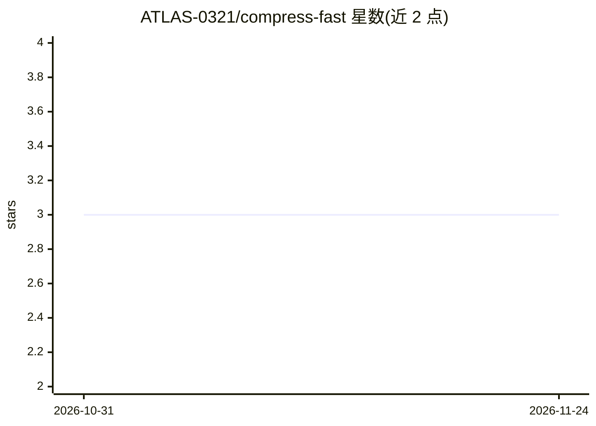

# ATLAS-0321/compress-fast

⭐ 3 · Python · MIT · 推送 2026-10-28 · [GitHub](https://github.com/ATLAS-0321/compress-fast) · 个人维护

**为 Hermes Agent 本地模型压缩提速的 OpenAI 兼容代理**

一个拦截 Hermes Agent 上下文压缩请求的 OpenAI 兼容代理：识别其压缩提示后，用规则在毫秒级抽取事实（工具调用、错误、文件读写、用户指令等），再由模型基于小摘要撰写推理部分（hybrid 模式），其余请求原样转发到模型服务器。仅依赖 Python 标准库，无需修改 Hermes。README 说明绑定 Hermes 压缩提示文本，Hermes 更新改动提示后需等待更新。

## 筛选速览

| 维度 | 判定 | 备注 |
|---|---|---|
| AI 角色 | `ai-ecosystem` | LLM/agent 周边工具 |
| 许可风险 | `permissive` | MIT |
| 部署形态 | `None` |  |
| 模型依赖 | local-ok | 支持本地模型 |
| 硬件要求 | — | 无带数字的原话,不猜 |
| 安装摩擦 | `low` | 无编译、无系统依赖或容器化 |
| 成熟度 | — | 结构信号不足 |

## 能力要点

- 规则抽取事实 + 模型写推理的 hybrid 混合压缩机制
- Drop-in OpenAI 兼容代理，无需 Hermes 补丁或插件钩子
- 仅用 Python 标准库实现，无第三方依赖
- 提供 shadow 模式与 quiz 工具对比/评测压缩效果

## 适用场景

- 本地模型跑 Hermes Agent 时缩短上下文压缩等待时间
- 在不修改 Hermes 本体的情况下替换其压缩后端
- 用 shadow 模式对比自建摘要与原摘要的事实覆盖率

## 场景标签

`模型网关` `模型评测` · 领域:Agent 开发

## 证据(README 行号)

> L17: No Hermes patches, no plugin hooks: a small OpenAI-compatible proxy that `auxiliary.compression`
> L24: Needs Python 3.10 or newer (standard library only), an OpenAI-compatible model server (llama.cpp,
> L58: compress-fast recognizes Hermes' compaction prompt and builds the summary itself:

## 星数曲线

2026-10-31 3 → 2026-11-24 3（+0）

---
*卡片 v1 · prompt 1.4 · 生成 2026-11-22 · 置信度 high · 依据 README sha `693da156b705` · [字段定义](../../DATASET.md)*
